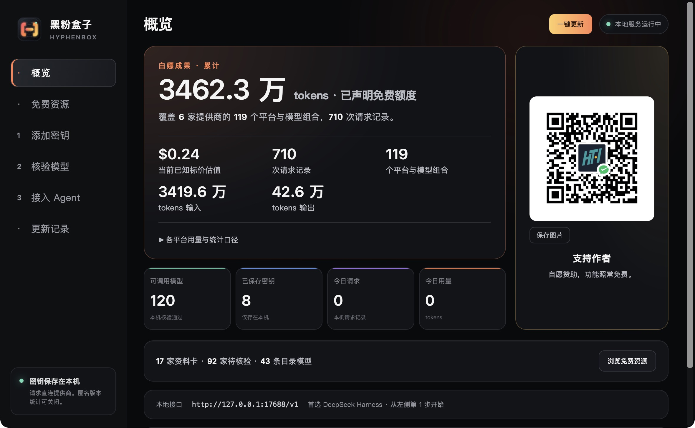
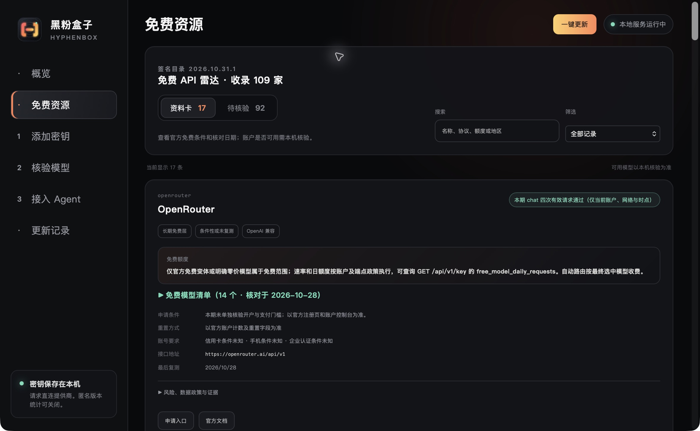
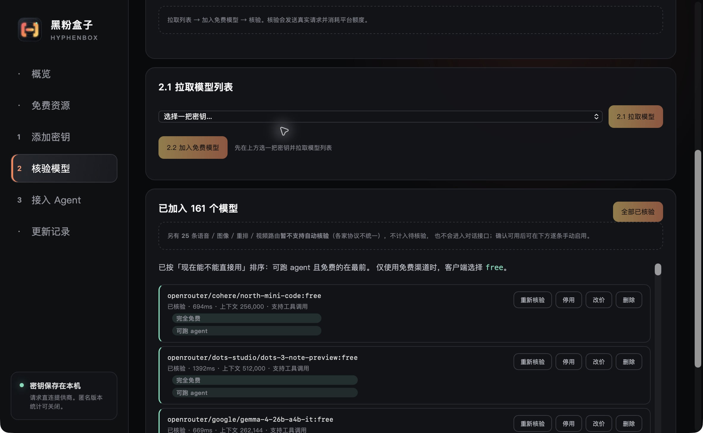
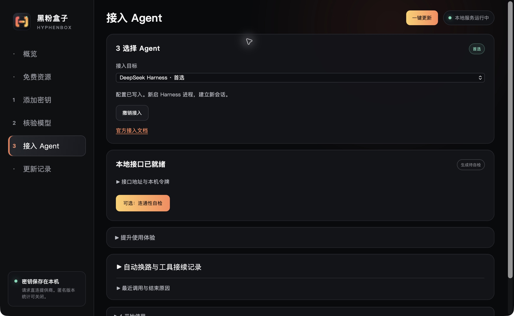
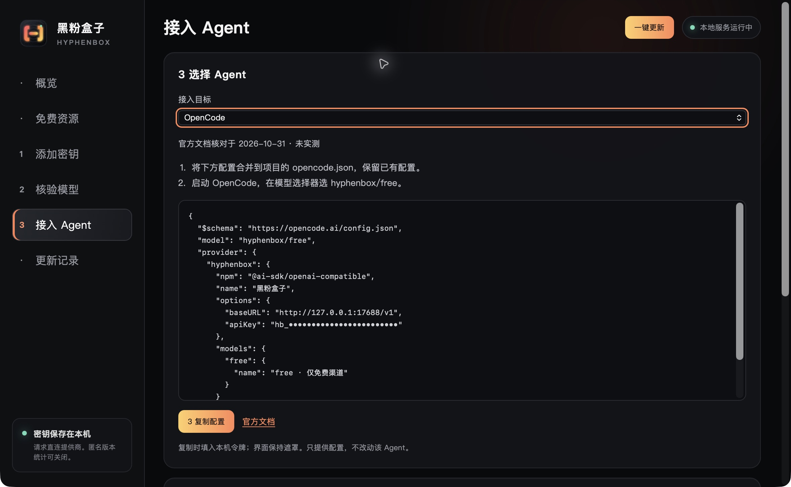
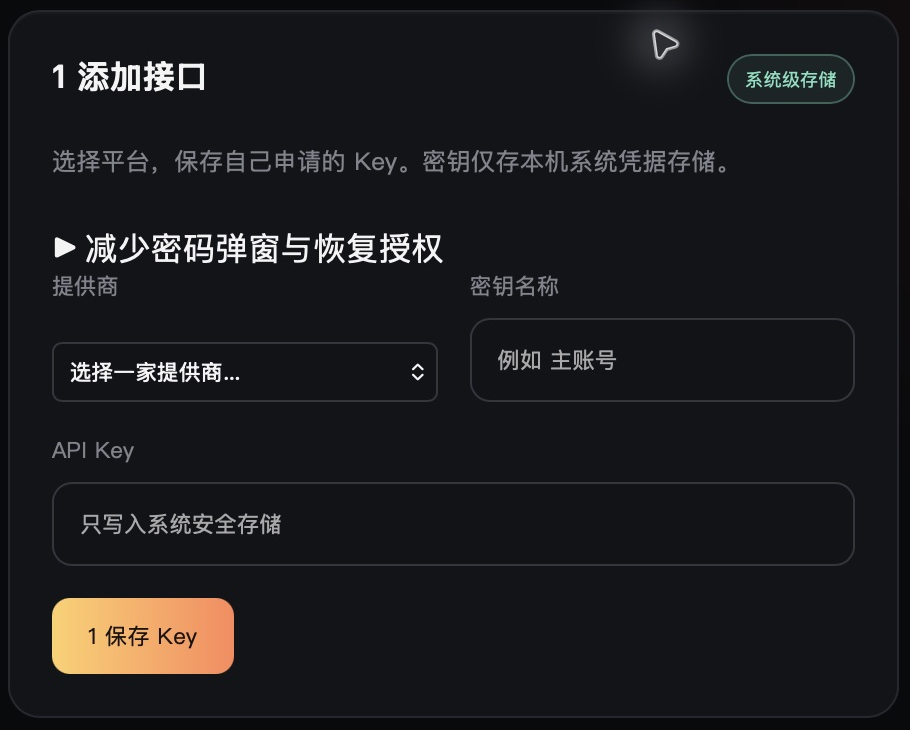

<!-- evergreen:intro:start -->

# HyphenBox · Free AI API discovery, model verification and unified routing

**Find suitable AI APIs, test them with your own credentials, and connect them to your coding tools.**

HyphenBox is a desktop API management application by HyphenTech. It combines a resource radar, a local credential vault, model verification and a unified local endpoint. Use it to compare free API conditions, manage providers and connect DeepSeek Harness, OpenCode, Cline or compatible clients. Resource cards include official evidence and review dates; availability is determined by real requests from your own account.

The application is free to download and requires no HyphenBox account. Apply for your own provider accounts and credentials. Some providers require international network access; regional, identity, payment and quota conditions are set by each provider.

<a href="README.md">简体中文</a> | <a href="README.zh-TW.md">繁體中文</a> | <a href="README.en.md">English</a>

 

<!-- evergreen:intro:end -->

<!-- recent-features:start -->
## Recent features and improvements (5 items)

- **1.0.5** · The fixed bottom bar is removed. Sidebar and key actions retain step numbers; model buttons align and size to their content.
- **1.0.5** · DeepSeek Harness is the preferred integration, with backup, managed configuration and undo; other Agents expand on selection.
- **1.0.5** · Official-documentation templates cover OpenCode, Cline, Roo Code, Continue, Codex CLI and generic compatible clients; no new live Agent validation is claimed.
- **1.0.5** · The overview combines repeated content while retaining free usage, daily metrics and the sponsorship QR; details and diagnostics expand on demand.
- **1.0.5** · Manual templates default to free; tokens remain masked and are retrieved on copy. The misleading localhost Cursor guide is removed.
<!-- recent-features:end -->

<!-- evergreen:demos:start -->
## ▶ Watch a practical demo

**Earlier-version demos of keys, client configuration and MCP. YouTube has the full introduction; these videos do not demonstrate the new Harness integration.**

| Bilibili | YouTube |
| :---: | :---: |
|  |  |

These videos show the versions available when recorded. Use the current release information on this page for downloads and capabilities. Narration is in Chinese.
<!-- evergreen:demos:end -->

**Current stable release: 1.0.5** · [Release notes](https://github.com/HackerChi-Hub/hyphenbox-release/releases/tag/v1.0.5)

## Download and install

The [latest release](https://github.com/HackerChi-Hub/hyphenbox-release/releases/latest) always points to the current official packages. Only actually uploaded installers appear below.

| System | Installer | Requirements |
|---|---|---|
| macOS | [Universal DMG](https://github.com/HackerChi-Hub/hyphenbox-release/releases/download/v1.0.5/HyphenBox_1.0.5_universal.dmg) | macOS 13+, Apple Silicon / Intel |

Version **1.0.5 is a universal macOS release** for Apple Silicon and Intel. Windows/Linux have no 1.0.5 installers; their actual [1.0.4 downloads remain available](https://github.com/HackerChi-Hub/hyphenbox-release/releases/tag/v1.0.4) and are not relabelled.

**This release's validation scope:** builds, offline regressions, configuration syntax, installation and UI checks. No new live model, Agent tool-task or failover result is claimed. [Historical 1.0.4 validation](https://github.com/HackerChi-Hub/hyphenbox-release/releases/download/v1.0.4/HyphenBox_1.0.4_macos.validation.json) retains its original version.

The Windows/Linux 1.0.4 installers include the signed built-in catalog without a preconfigured online catalog service. Model verification, routing and requests still work with your own keys; online catalog refresh requires a separately configured controlled service.

Screenshots were captured on 2026-10-31 from the installed macOS 1.0.5 stable release. Counts describe that device at capture time, not guaranteed availability. Keys, account details and private conversations are not shown. The historical failover image keeps its original version label; translated documentation does not imply a translated application UI.

<!-- evergreen:capabilities:start -->
## What HyphenBox does

| Feature | Capability |
| --- | --- |
| Free API radar | Search resources by free tier type, quota and application conditions; inspect endpoints, models, risks, official evidence and review dates; distinguish information cards from unverified candidates |
| Credential vault | Store your own officially obtained credentials in the system credential store; masked display and multiple keys |
| Model verification | Fetch models with your credentials, select free candidates and send small real requests; verify chat and embedding models with their respective endpoints |
| Cost and capability labels | Separate fully free, limited free quota, balance deductions, unknown prices and paid usage; unknown prices do not automatically qualify as free |
| Local routing | Listen only on `127.0.0.1`; provide a compatible endpoint, multiple-key attempts, rate-limit cooldown and failover |
| Agent setup | DeepSeek Harness is preferred, with backup, managed configuration and undo; official-documentation templates cover OpenCode, Cline, Roo Code, Continue, Codex CLI and generic compatible clients; no new live validation is claimed |
| Optional sponsorship | The bundled QR code is directly visible on all three platforms without a usage or network gate; sponsorship does not unlock features |
| Diagnostics | Inspect local requests, token usage, output budgets and finish reasons to distinguish truncation, rate limits and upstream errors |
| Independent catalog updates | Verify the controlled catalog's signatures, version and file hashes before applying resource updates without reinstalling the app |

### Discover resources, then test your own account

Free tiers, one-time trials, temporary promotions and self-hosted open-source models have different conditions. Check the official provider page and your own account entitlements. A model appearing on a card does not prove that your key can call it.

### Verify models and route by capability

Model lists come from your credentials; local verification determines usable routes. Add free candidates in batches, test them, re-test or disable individual routes. Embeddings use embedding endpoints. Audio, image, video and reranking capabilities are not all automatically verified and are not inserted into the chat model pool.

### Connect an Agent

Use `http://127.0.0.1:17688/v1` and HyphenBox's local unified token instead of entering every upstream key in the client. DeepSeek Harness configuration can be written and undone; other clients use the in-app instructions. Agent-facing model lists exclude routes tested as lacking tool calling.

Harness uses its official native OpenAI adapter. HyphenBox appends a managed configuration layer and saves only the loopback token in the Harness-home environment file, not upstream keys. Existing providers and private sessions are preserved. Start a new Harness process and session after the initial connection; existing sessions retain their own model selections. New sessions default to `free` when eligible free candidates exist; `auto` may use paid routes you added. Undo removes only the managed layer and its token.

Follow the numbered sidebar: **1 Add a key → 2 Verify models → 3 Connect an Agent**, then expand “4 Start using it” on the connection page. The fixed bottom bar is removed; key buttons retain step numbers and size to their content. Harness is selected first; other guides expand on selection. Manual templates default to `free`. Tokens stay masked and are retrieved only on copy. This release checks official documentation and configuration syntax, without new live Agent requests.

Sources checked on 2026-10-31: [OpenCode](https://opencode.ai/docs/providers/#custom-provider), [Cline](https://docs.cline.bot/provider-config/openai-compatible), [Roo Code](https://docs.roocode.com/providers/openai-compatible), [Continue](https://docs.continue.dev/customize/model-providers/top-level/openai), [Codex CLI](https://developers.openai.com/codex/config-advanced/#custom-model-providers). [Cursor states that requests pass through its servers](https://cursor.com/docs/settings/api-keys), so the old direct-localhost guide has been removed.

### Choose free or auto

- `free`: try only routes that meet known free conditions, pass verification and suit the request. Daily, per-minute and account limits still apply; unlimited calls are not guaranteed.
- `auto`: choose by capabilities, request size, cost information and cooldowns. **It may use paid routes you have added.** Select `free` if you only want the eligible free pool.
- An explicit model: select a particular route; upstream context, output and tool limitations still apply.

The router cools down failing routes and tries eligible alternatives. It returns an error if none work. A streaming response that already emitted content is not guaranteed to switch seamlessly to another model, and the software cannot restore an exhausted provider quota.
### Explore eligible free candidates instead of stopping at a fixed count (1.0.3+)

When the client selects `free`, routing no longer stops at the old fixed route-hop or four-credential limit. It continues through added, verified, enabled free candidates suitable for the request, preferring previously untried providers when changing routes. Cooling, unauthorized, unsuitable or no-longer-free candidates are skipped according to current state. Local free eligibility is rechecked before dispatch; paid credentials and chargeable models are not automatic fallbacks.

The pre-output budget is five minutes in total and up to 60 seconds per attempt. Once valid streamed output begins, this routing budget does not cut it off. A route/credential pair is not dispatched repeatedly, except for one existing retry to adapt an explicit parameter limit. If time runs out before the queue is exhausted, the report shows remaining routes and the stop reason instead of claiming every quota is exhausted. Clients can impose shorter timeouts, and upstream quota is not reserved. `auto` retains its existing bounded failover policy.

### Fewer password prompts and interrupted tool-turn recovery (1.0.2+)

Normal requests do not initiate system password dialogs. Concurrent reads of one key are coalesced and failures back off. On macOS, newly saved and migrated keys share one application Keychain item. Authorize from the vault screen when convenient. Legacy independent items may still require separate approval during the first migration. Locks, permissions or signing changes may require authorization again; a permanent one-password guarantee is not offered. Keys are not moved into plaintext files.

For `free` and `auto`, an unreadable credential is isolated while other eligible routes can be tried. Local authorization failures are not labelled as upstream quota exhaustion. Explicit structured quota errors, including errors wrapped in HTTP 200, participate in cooldown and failover. Normal answers and content refusals are not reclassified merely for mentioning quotas.

If all tool results in the current turn have returned, the router can build an executed-results checkpoint, remove old provider signatures and let an alternative model continue without replaying old tool calls. Missing results, conflicting IDs and streams that already delivered partial output cannot be promised seamless recovery. A different route can mean a different model and behavior. Client Setup shows the latest five routing/checkpoint records; reaching an upstream does not prove completion of the whole task.

Historical 1.0.3 record (2026-10-24, not a new 1.0.5 test): the first provider could not fit the request within the account token allowance, and the router selected another eligible free route. This test result is not a guarantee for every account or task.

### Local usage and current-price estimates

Usage is grouped by the actual credential's current free, paid or undeclared classification. Undeclared usage is excluded from free totals. Negative price sentinels, non-numeric values and infinity are excluded from estimates; missing prices and explicit zero prices are distinguished. Current-price estimates are neither bills nor proven savings, and no fixed zero-paid claim is displayed.

Changing a price or billing declaration changes historical summaries; historical requests do not contain billing snapshots. Request counts can include streams interrupted after starting. Model counts represent provider-model combinations, not independent base models or completed tasks.

Expand the overview's free-usage details for provider breakdowns and calculation rules; the main screen keeps the totals and daily metrics.

Dedicated safety classifiers such as Qwen3Guard, Llama Guard and GPT OSS Safeguard are isolated from general free/auto chat, including existing routes, while usage history is preserved.
<!-- evergreen:capabilities:end -->

<!-- evergreen:installation-privacy:start -->
## Follow the four steps

1. Read the resource conditions, apply at the official provider, and save your own key in the vault.
2. Fetch models, add candidates and verify them before using them as routes.
3. Select the preferred Harness integration or another Agent and write or copy its configuration.
4. Keep HyphenBox running; start a new Agent process and session, choose `free` and run your task.

## First launch and signatures

The macOS package uses a fixed local signature and has no Apple Developer ID signing or notarization. If blocked, confirm the download source and allow it through System Settings → Privacy & Security. Windows installers have no commercial code signing and may show SmartScreen prompts.

Download only from this repository's releases and compare the supplied SHA-256 files. Updater signatures and operating-system commercial code signatures serve different purposes.

## API compatibility

The local token protects `/v1/models`, streaming `/v1/chat/completions`, `/v1/embeddings`, and compatibility conversions for `/v1/completions` and `/v1/responses`. Available features depend on the actual routes. Tool calls, reasoning signatures, multimodal inputs and output limits vary by model and protocol. Image, video, audio and reranking generation are not universally supported through the local chat endpoint. For truncated answers, inspect the recent-request budget and finish reason, then check client settings and provider limits.

## Application and resource updates

The top-bar update control checks both the signed catalog and application releases. Valid catalog updates apply independently; application updates read the release metadata. Packages are signed with an offline private key and verified by the embedded public key. If your platform has no updater entry or an older version cannot upgrade, download an available installer manually.

## Privacy and repository boundaries

- Provider keys stay in the local system credential store. The local unified token stays in the app data directory and authenticates the loopback endpoint.
- Requests go directly from your computer to the chosen provider. Keys, prompts and responses do not pass through HyphenBox's catalog or statistics servers. The provider still receives request data and applies its own privacy policy.
- Anonymous version statistics are enabled by default and can be disabled. At most once per UTC day, the app reports an anonymous device hash, version, OS, architecture and date. It does not report credentials, conversations, usage or selected providers/models.
- The control is collapsed by default under Client Setup → Improve user experience. Expand it to inspect the scope and state or disable reporting; your existing preference is preserved.
- This repository contains downloads, documentation, screenshots and update metadata. Application source, the resource catalog, raw research/probe data, private service settings and signing private keys are not public here.
- HyphenBox does not collect leaked keys, distribute shared accounts or bypass quotas. “Free API” means a provider-authorized entitlement, not permanent availability.
<!-- evergreen:installation-privacy:end -->

<!-- evergreen:use-cases:start -->
## Use cases and questions

| Need | Approach |
| --- | --- |
| Discover free model APIs | Compare official free conditions, quotas, application requirements and review dates |
| Configure a coding assistant | Follow client setup using the local endpoint and token |
| Manage providers and keys | Obtain your own credentials, store them locally and verify actual model calls |
| Diagnose rate limits or truncation | Inspect recent requests, budgets and finish reasons against provider constraints |

**Are free APIs unlimited forever?** No. Providers may change free tiers, trials and promotions; catalog entries do not prove your account works.

**How do I avoid paid routes?** Choose `free`; `auto` may select paid routes you added.

**Does it run local models?** Its main purpose is API management and routing. Use LocalBrain for models running on your computer.

**Does it apply for accounts or keys for me?** No. Meet each provider's official conditions yourself, then verify your credentials.
<!-- evergreen:use-cases:end -->

## Report an issue

Include OS, version, client, steps and sanitized errors in [Issues](https://github.com/HackerChi-Hub/hyphenbox-release/issues). Log locations:

- Windows: `%LOCALAPPDATA%\top.hyphentech.hyphenbox\logs\hyphenbox.log`
- macOS: `~/Library/Logs/top.hyphentech.hyphenbox/hyphenbox.log`
- Linux: `~/.local/share/top.hyphentech.hyphenbox/logs/hyphenbox.log`

Check attachments despite automatic redaction. Never post complete keys, tokens, account details, private conversations or private service addresses.

<!-- evergreen:discovery:start -->
## More from HyphenTech

| Application | Purpose | Official download |
| --- | --- | --- |
| LocalBrain | Local models, file and media tools | [LocalBrain](https://github.com/HackerChi-Hub/localbrain-releases) |
| HyphenScreen | Screen recording, editing, captions and animation | [HyphenScreen](https://github.com/HackerChi-Hub/HyphenScreen-Releases) |
| ScreenLex | Movie English, vocabulary and review | [ScreenLex](https://github.com/HackerChi-Hub/screenlex-download) |
| HyphenBox | API discovery, verification and routing | [HyphenBox](https://github.com/HackerChi-Hub/hyphenbox-release) |

Share this repository homepage so others can choose the latest installer. Follow [Bilibili](https://space.bilibili.com/1846717524), [YouTube](https://www.youtube.com/@hyphentech_top), or the [HyphenTech website](https://hyphentech.top). On WeChat, search for 黑粉科技.
<!-- evergreen:discovery:end -->
