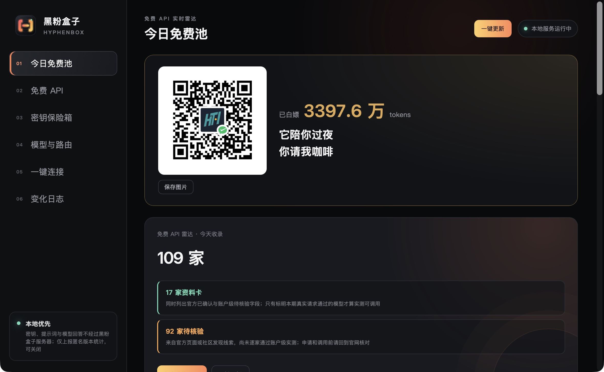
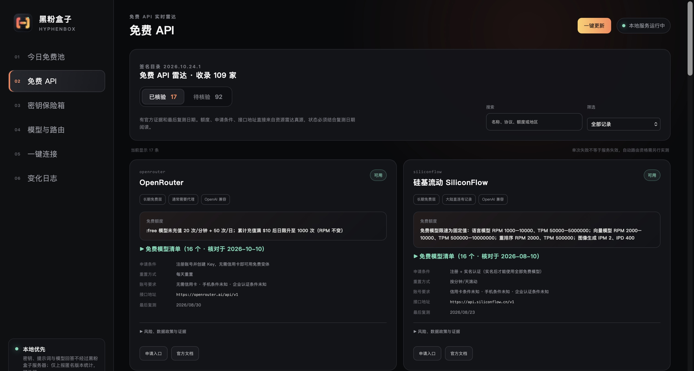
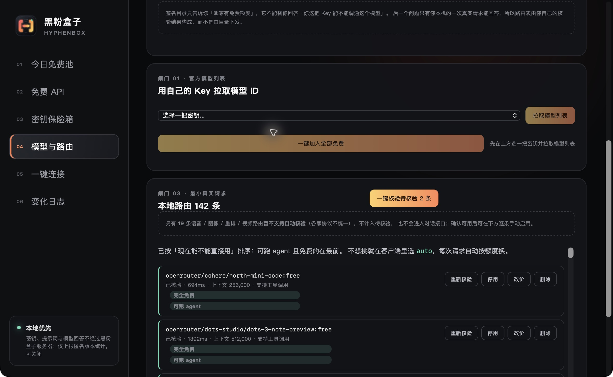
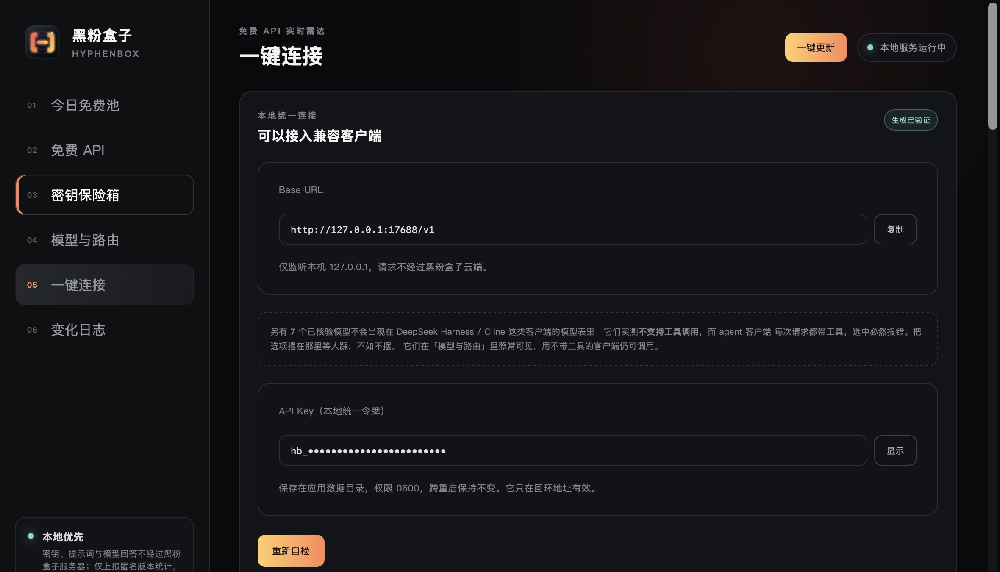
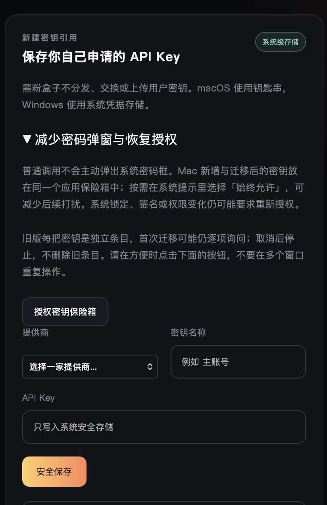
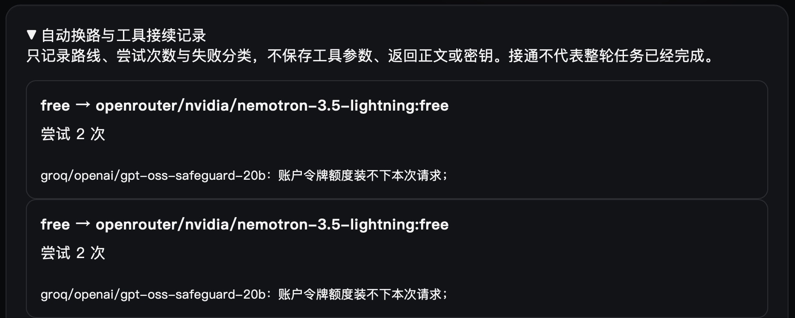

<!-- evergreen:intro:start -->

# HyphenBox · Free AI API discovery, model verification and unified routing

**Find suitable AI APIs, test them with your own credentials, and connect them to your coding tools.**

HyphenBox is a desktop API management application by HyphenTech. It combines a resource radar, a local credential vault, model verification and a unified local endpoint. Use it to compare free API conditions, manage providers and connect DeepSeek Harness, Cursor, Cline or compatible clients. Resource cards include official evidence and review dates; availability is determined by real requests from your own account.

The application is free to download and requires no HyphenBox account. Apply for your own provider accounts and credentials. Some providers require international network access; regional, identity, payment and quota conditions are set by each provider.

<a href="README.md">简体中文</a> | <a href="README.zh-TW.md">繁體中文</a> | <a href="README.en.md">English</a>

 

<!-- evergreen:intro:end -->

<!-- recent-features:start -->
## Recent features and improvements (5 items)

- **1.0.2** · A shared macOS application vault and foreground authorization, coalesced reads and failure backoff reduce repeated password prompts.
- **1.0.2** · Automatic routing isolates unreadable credentials and tries eligible alternatives without mislabelling local authorization failures as exhausted quotas.
- **1.0.2** · Structured quota errors wrapped in HTTP 200 are recognized; normal answers and content refusals are not quota errors.
- **1.0.2** · Complete tool results can form an executed checkpoint for failover continuation without replaying old tool calls.
- **1.0.2** · Client Setup shows recent routing and tool-checkpoint records with routes, attempt counts and sanitized failure categories.
<!-- recent-features:end -->

<!-- evergreen:demos:start -->
## ▶ Watch a practical demo

**Earlier-version demos of keys, client configuration and MCP. YouTube has the full introduction; these videos do not demonstrate the new Harness integration.**

| Bilibili | YouTube |
| :---: | :---: |
|  |  |

These videos show the versions available when recorded. Use the current release information on this page for downloads and capabilities. Narration is in Chinese.
<!-- evergreen:demos:end -->

**Current stable release: 1.0.2** · [Release notes](https://github.com/HackerChi-Hub/hyphenbox-release/releases/tag/v1.0.2)

## Download and install

The [latest release](https://github.com/HackerChi-Hub/hyphenbox-release/releases/latest) always points to the current official packages. Only actually uploaded installers appear below.

| System | Installer | Requirements |
|---|---|---|
| macOS | [Universal DMG](https://github.com/HackerChi-Hub/hyphenbox-release/releases/download/v1.0.2/HyphenBox_1.0.2_universal.dmg) | macOS 13+, Apple Silicon / Intel |
| Windows | [EXE installer](https://github.com/HackerChi-Hub/hyphenbox-release/releases/download/v1.0.2/HyphenBox_1.0.2_x64-setup.exe) | Windows 10 / 11, x64 |
| Windows | [MSI](https://github.com/HackerChi-Hub/hyphenbox-release/releases/download/v1.0.2/HyphenBox_1.0.2_x64_en-US.msi) | Windows 10 / 11, x64 |
| Linux | [AppImage](https://github.com/HackerChi-Hub/hyphenbox-release/releases/download/v1.0.2/HyphenBox_1.0.2_amd64.AppImage) | x64 desktop Linux; system keyring / Secret Service required |
| Linux | [deb](https://github.com/HackerChi-Hub/hyphenbox-release/releases/download/v1.0.2/HyphenBox_1.0.2_amd64.deb) | x64 desktop Linux; system keyring / Secret Service required |
| Linux | [rpm](https://github.com/HackerChi-Hub/hyphenbox-release/releases/download/v1.0.2/HyphenBox-1.0.2-1.x86_64.rpm) | x64 desktop Linux; system keyring / Secret Service required |

Version **1.0.2** now offers macOS, Windows and Linux installers. Harness integration began in 1.0.1; this release adds credential-read backoff, structured quota-error recognition and conditional tool-checkpoint continuation. The shared application Keychain item is a macOS improvement; Windows and Linux retain their own system secure-storage backends.

Screenshots were captured on 2026-10-24 from the actual macOS 1.0.2 stable release. Provider, model and usage counts describe that captured session, not quantities guaranteed to every user. Resource cards and unverified candidates are not successful local tests. Documentation translations do not imply a translated application UI.

<!-- evergreen:capabilities:start -->
## What HyphenBox does

| Feature | Capability |
| --- | --- |
| Free API radar | Search resources by free tier type, quota and application conditions; inspect endpoints, models, risks, official evidence and review dates; distinguish information cards from unverified candidates |
| Credential vault | Store your own officially obtained credentials in the system credential store; masked display and multiple keys |
| Model verification | Fetch models with your credentials, select free candidates and send small real requests; verify chat and embedding models with their respective endpoints |
| Cost and capability labels | Separate fully free, limited free quota, balance deductions, unknown prices and paid usage; unknown prices do not automatically qualify as free |
| Local routing | Listen only on `127.0.0.1`; provide a compatible endpoint, multiple-key attempts, rate-limit cooldown and failover |
| Client setup | Back up, write and undo DeepSeek Harness configuration; provide copyable settings and instructions for Cursor, Cline and compatible SDKs |
| Optional sponsorship | The bundled QR code is directly visible on all three platforms without a usage or network gate; sponsorship does not unlock features |
| Diagnostics | Inspect local requests, token usage, output budgets and finish reasons to distinguish truncation, rate limits and upstream errors |
| Independent catalog updates | Verify the controlled catalog's signatures, version and file hashes before applying resource updates without reinstalling the app |

### Discover resources, then test your own account

Free tiers, one-time trials, temporary promotions and self-hosted open-source models have different conditions. Check the official provider page and your own account entitlements. A model appearing on a card does not prove that your key can call it.

### Verify models and route by capability

Model lists come from your credentials; local verification determines usable routes. Add free candidates in batches, test them, re-test or disable individual routes. Embeddings use embedding endpoints. Audio, image, video and reranking capabilities are not all automatically verified and are not inserted into the chat model pool.

### Connect a client

Use `http://127.0.0.1:17688/v1` and HyphenBox's local unified token instead of entering every upstream key in the client. DeepSeek Harness configuration can be written and undone; other clients use the in-app instructions. Agent-facing model lists exclude routes tested as lacking tool calling.

Harness uses its official native OpenAI adapter. HyphenBox appends a managed configuration layer and saves only the loopback token in the Harness-home environment file, not upstream keys. Existing providers and private sessions are preserved. Start a new Harness process and session after the initial connection; existing sessions retain their own model selections. New sessions default to `free` when eligible free candidates exist; `auto` may use paid routes you added. Undo removes only the managed layer and its token.

### Choose free or auto

- `free`: try only routes that meet known free conditions, pass verification and suit the request. Daily, per-minute and account limits still apply; unlimited calls are not guaranteed.
- `auto`: choose by capabilities, request size, cost information and cooldowns. **It may use paid routes you have added.** Select `free` if you only want the eligible free pool.
- An explicit model: select a particular route; upstream context, output and tool limitations still apply.

The router cools down failing routes and tries eligible alternatives. It returns an error if none work. A streaming response that already emitted content is not guaranteed to switch seamlessly to another model, and the software cannot restore an exhausted provider quota.
### Fewer password prompts and interrupted tool-turn recovery (1.0.2+)

Normal requests do not initiate system password dialogs. Concurrent reads of one key are coalesced and failures back off. On macOS, newly saved and migrated keys share one application Keychain item. Authorize from the vault screen when convenient. Legacy independent items may still require separate approval during the first migration. Locks, permissions or signing changes may require authorization again; a permanent one-password guarantee is not offered. Keys are not moved into plaintext files.

For `free` and `auto`, an unreadable credential is isolated while other eligible routes can be tried. Local authorization failures are not labelled as upstream quota exhaustion. Explicit structured quota errors, including errors wrapped in HTTP 200, participate in cooldown and failover. Normal answers and content refusals are not reclassified merely for mentioning quotas.

If all tool results in the current turn have returned, the router can build an executed-results checkpoint, remove old provider signatures and let an alternative model continue without replaying old tool calls. Missing results, conflicting IDs and streams that already delivered partial output cannot be promised seamless recovery. A different route can mean a different model and behavior. Client Setup shows the latest five routing/checkpoint records; reaching an upstream does not prove completion of the whole task.

This record comes from a real local request: the first provider could not fit the request within the account token allowance, and the router selected another eligible free route. This test result is not a guarantee for every account or task.

<!-- evergreen:capabilities:end -->

<!-- evergreen:installation-privacy:start -->
## Start in three steps

1. Read the resource conditions, apply at the official provider, and save your own key in the vault.
2. Fetch models, add candidates and verify them before using them as routes.
3. Follow client setup and perform an actual connectivity check. Select `free` for the eligible free pool.

## First launch and signatures

The macOS package uses a fixed local signature and has no Apple Developer ID signing or notarization. If blocked, confirm the download source and allow it through System Settings → Privacy & Security. Windows installers have no commercial code signing and may show SmartScreen prompts.

Download only from this repository's releases and compare the supplied SHA-256 files. Updater signatures and operating-system commercial code signatures serve different purposes.

## API compatibility

The local token protects `/v1/models`, streaming `/v1/chat/completions`, `/v1/embeddings`, and compatibility conversions for `/v1/completions` and `/v1/responses`. Available features depend on the actual routes. Tool calls, reasoning signatures, multimodal inputs and output limits vary by model and protocol. Image, video, audio and reranking generation are not universally supported through the local chat endpoint. For truncated answers, inspect the recent-request budget and finish reason, then check client settings and provider limits.

## Application and resource updates

The top-bar update control checks both the signed catalog and application releases. Valid catalog updates apply independently; application updates read the release metadata. Packages are signed with an offline private key and verified by the embedded public key. If your platform has no updater entry or an older version cannot upgrade, download an available installer manually.

## Privacy and repository boundaries

- Provider keys stay in the local system credential store. The local unified token stays in the app data directory and authenticates the loopback endpoint.
- Requests go directly from your computer to the chosen provider. Keys, prompts and responses do not pass through HyphenBox's catalog or statistics servers. The provider still receives request data and applies its own privacy policy.
- Anonymous version statistics are enabled by default and can be disabled. At most once per UTC day, the app reports an anonymous device hash, version, OS, architecture and date. It does not report credentials, conversations, usage or selected providers/models.
- The control is collapsed by default under Client Setup → Improve user experience. Expand it to inspect the scope and state or disable reporting; your existing preference is preserved.
- This repository contains downloads, documentation, screenshots and update metadata. Application source, the resource catalog, raw research/probe data, private service settings and signing private keys are not public here.
- HyphenBox does not collect leaked keys, distribute shared accounts or bypass quotas. “Free API” means a provider-authorized entitlement, not permanent availability.
<!-- evergreen:installation-privacy:end -->

<!-- evergreen:use-cases:start -->
## Use cases and questions

| Need | Approach |
| --- | --- |
| Discover free model APIs | Compare official free conditions, quotas, application requirements and review dates |
| Configure a coding assistant | Follow client setup using the local endpoint and token |
| Manage providers and keys | Obtain your own credentials, store them locally and verify actual model calls |
| Diagnose rate limits or truncation | Inspect recent requests, budgets and finish reasons against provider constraints |

**Are free APIs unlimited forever?** No. Providers may change free tiers, trials and promotions; catalog entries do not prove your account works.

**How do I avoid paid routes?** Choose `free`; `auto` may select paid routes you added.

**Does it run local models?** Its main purpose is API management and routing. Use LocalBrain for models running on your computer.

**Does it apply for accounts or keys for me?** No. Meet each provider's official conditions yourself, then verify your credentials.
<!-- evergreen:use-cases:end -->

## Report an issue

Include OS, version, client, steps and sanitized errors in [Issues](https://github.com/HackerChi-Hub/hyphenbox-release/issues). Log locations:

- Windows: `%LOCALAPPDATA%\top.hyphentech.hyphenbox\logs\hyphenbox.log`
- macOS: `~/Library/Logs/top.hyphentech.hyphenbox/hyphenbox.log`
- Linux: `~/.local/share/top.hyphentech.hyphenbox/logs/hyphenbox.log`

Check attachments despite automatic redaction. Never post complete keys, tokens, account details, private conversations or private service addresses.

<!-- evergreen:discovery:start -->
## More from HyphenTech

| Application | Purpose | Official download |
| --- | --- | --- |
| LocalBrain | Local models, file and media tools | [LocalBrain](https://github.com/HackerChi-Hub/localbrain-releases) |
| HyphenScreen | Screen recording, editing, captions and animation | [HyphenScreen](https://github.com/HackerChi-Hub/HyphenScreen-Releases) |
| ScreenLex | Movie English, vocabulary and review | [ScreenLex](https://github.com/HackerChi-Hub/screenlex-download) |
| HyphenBox | API discovery, verification and routing | [HyphenBox](https://github.com/HackerChi-Hub/hyphenbox-release) |

Share this repository homepage so others can choose the latest installer. Follow [Bilibili](https://space.bilibili.com/1846717524), [YouTube](https://www.youtube.com/@hyphentech_top), or the [HyphenTech website](https://hyphentech.top). On WeChat, search for 黑粉科技.
<!-- evergreen:discovery:end -->
