<!-- evergreen:intro:start -->

# 黑粉盒子 HyphenBox · 免费 AI API 雷达、模型核验与统一接口

**找到合适的免费 AI 接口，用自己的密钥测通，再接入常用 AI 编程工具。**

黑粉盒子是黑粉科技开发的桌面 AI API 管理工具，把免费资源发现、本机密钥保险箱、模型核验、本地统一路由和独立图片／视频工具放在一起。DeepSeek Harness 支持一键接入对话与免费媒体工具，其他兼容客户端保留配置指引。资源条件有官方证据与核对日期；模型是否能用，以你自己的账户和真实请求为准。

软件免费下载，不需注册黑粉盒子账号。平台密钥需自行申请，部分平台需要国际网络；免费额度、地区和账户条件以平台为准。

<a href="README.md">简体中文</a> | <a href="README.zh-TW.md">繁體中文</a> | <a href="README.en.md">English</a>

 

<!-- evergreen:intro:end -->

<!-- recent-features:start -->
## 近期新增与改进（最近 5 项）

- **1.0.7** · 图片与视频历史支持单条移除、批量清理已结束和撤销；默认最近六条，重开后仍可恢复。
- **1.0.7** · 新增可复用的平台协议配置；统一平台、已保存密钥、模型与参数，同协议新模型不再新增专用代码。
- **1.0.7** · 区分周期额度、限时零价、社区队列和新用户试用；账户条件先确认，付费及未声明凭据不放行。
- **1.0.7** · 提交、查询、失败响应和下载独立留档；恢复只处理原任务，清理历史仍保留文件与幂等键。
- **1.0.7** · Harness原有8项原生媒体工具读取同一套渠道与参数，图片／视频继续使用统一的第3步入口。
<!-- recent-features:end -->

<!-- evergreen:demos:start -->
## ▶ 使用演示

**早期版本的密钥保存、客户端配置与 MCP 演示；YouTube 为完整介绍。视频不展示新版 Harness 接入。**

| Bilibili | YouTube |
| :---: | :---: |
|  |  |

视频演示的是拍摄时的版本；安装包与当前功能以本页正式发行信息为准。视频为中文讲解。
<!-- evergreen:demos:end -->

**当前正式版：1.0.7** · [发行说明](https://github.com/HackerChi-Hub/hyphenbox-release/releases/tag/v1.0.7)

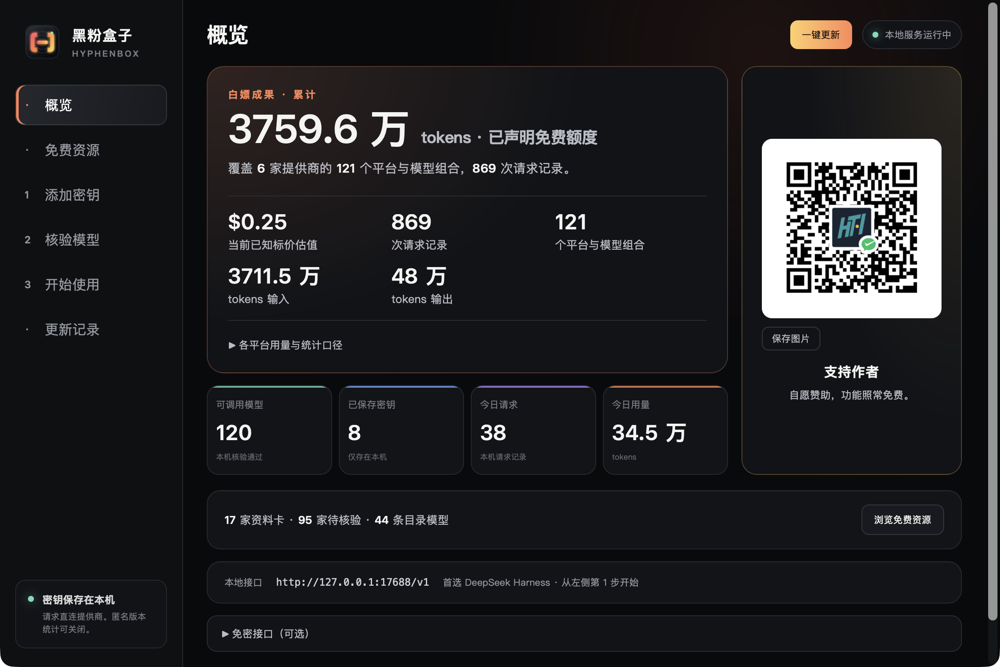

截图拍摄于 2026 年 11 月 2 日：概览和本轮媒体界面来自安装后的 macOS 1.0.7 正式版；其余截图保留文件名中的 1.0.6 历史版本。数字代表拍摄设备当时状态，账户与私人信息已裁去；历史换路图单独标明版本。

<!-- evergreen:capabilities:start -->
## 它能做什么

免费清单解决“到哪里找”，却不能回答“我这把密钥现在能不能用”。黑粉盒子把资源发现和本机调用分开处理：先看官方条件，再用自己的账户核验，最后接入客户端。

| 功能 | 当前能力 |
|---|---|
| 免费 API 雷达 | 搜索和筛选资源，查看免费类型、额度、申请门槛、接口地址、模型清单、风险、官方证据及核对日期；区分资料卡和待核验候选 |
| 密钥保险箱 | 保存自己从官方渠道取得的密钥，使用系统凭据存储；界面默认遮罩，支持多把密钥 |
| 模型发现与核验 | 用自己的密钥拉取模型列表，筛选免费模型、批量加入并发送最小真实请求；对话和向量模型按用途验证，不把向量模型拿去做聊天测试 |
| 费用与能力标识 | 区分完全免费、免费额度、扣余额、价格未知和自费；展示核验状态、工具调用能力等信息，未知价格不会自动算免费 |
| 本地统一路由 | 只监听 `127.0.0.1`，提供兼容接口、多密钥尝试、限流冷却和故障切换；免费路线与一般自动路线分开 |
| Agent 接入 | 首选 DeepSeek Harness，一次写入对话配置与图片／视频工具，支持备份和撤销；工具随安装包提供，无需另装运行环境。其他 Agent 保留官方文档配置指引 |
| 免费图片与视频工具 | 统一选择平台、密钥与模型，复用平台协议配置；区分免费档与试用条件。历史可单条移除、批量清理和撤销，无付费回退 |
| 媒体任务与文件 | 先保存任务再提交；同一任务不重复生成，保留状态、事件与文件哈希。已受理视频只查询原任务，重开可恢复查询；结果未知不自动重交 |
| 自愿赞助 | 三平台首页直接显示随包赞助码，不依赖用量或网络；赞助不解锁功能，也不影响免费使用 |
| 调用诊断与统计 | 查看本机请求与词元用量；最近调用诊断显示输出预算、结束原因等信息，帮助区分输出长度限制、限流和上游错误 |
| 独立目录更新 | 软件定期读取受控的签名目录，验证签名、版本和文件哈希；更新资源信息不必重新下载安装包 |

### 免费 API 雷达

免费档、一次性试用、限时活动与开源自托管不是同一回事。先看免费类型、申请条件和核对日期，再回到平台官方页面确认自己账户的权益。资料卡里的模型清单也不能代替本机真实调用。

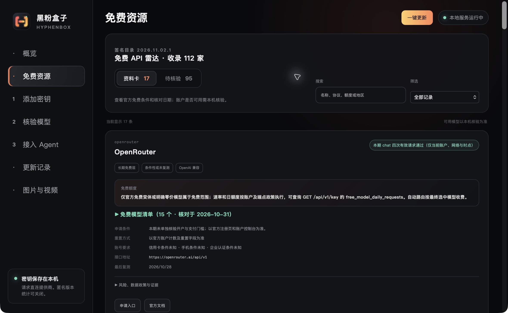

### 模型与路由

模型列表来自你自己的凭据，路由资格来自本机核验结果。可以批量加入免费模型、核验待验证路线，也可以重新核验、停用或删除单条路线。向量模型走向量接口；语音、图像、视频与重排序等用途目前不能全部自动核验，也不会混入聊天接口。

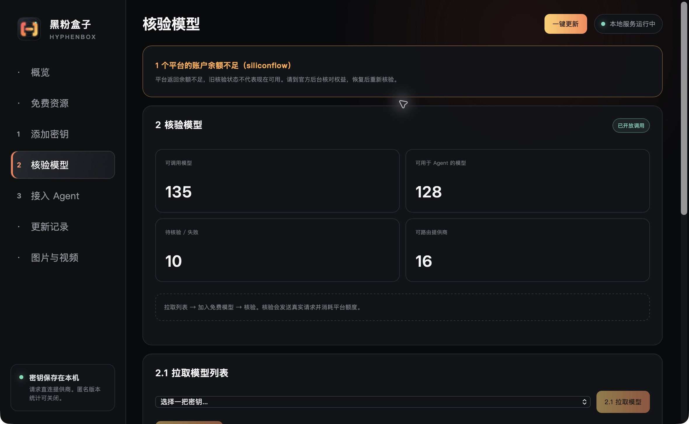

### 接入 Agent

统一地址是 `http://127.0.0.1:17688/v1`，客户端使用黑粉盒子的本地统一令牌，不需要逐个平台填写上游密钥。DeepSeek Harness 可以直接写入配置并撤销；其他客户端按应用内指引手动填写。面向智能体客户端的模型列表会筛掉已实测不支持工具调用的路线。

Harness 使用官方对话适配器与 MCP 客户端插件。写入只追加黑粉盒子的受管配置层和原生媒体工具，并保存本机令牌引用，不复制上游密钥；原有提供商与私人会话保留。首次连接后请新启 Harness 进程、建立新会话；已有会话的模型选择不变。一键接入默认 `free`，没有合格免费对话模型时停止写入，不自动改选付费路线。撤销会移除受管对话配置、媒体工具及本机令牌，不删除其他配置或会话。

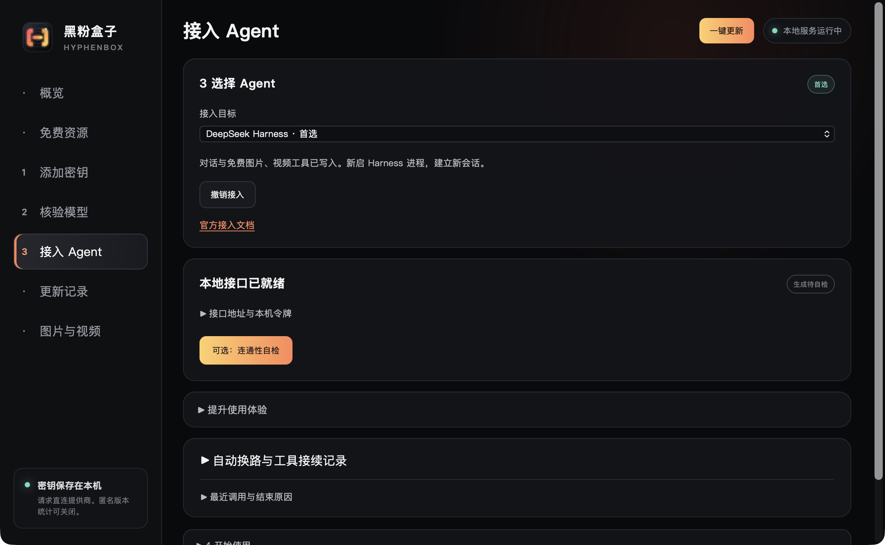

左侧统一为 **1 添加密钥 → 2 核验模型 → 3 开始使用**。第3步包含「接入Agent／生成图片／生成视频」；直接生成媒体无需先连接Agent，文字模型仍须在第2步核验。Harness连接后新启进程、新建会话。底部没有固定栏，手动模板默认free。1.0.6安装版原生桥曾由Harness独立会话完成渠道查询、图片生成、查询与保存；视频提交与队列恢复另做真实请求，未取得成片。其他Agent指引不等于本轮实测。

### 图片与视频

在「3 开始使用」选择图片或视频，再选择平台、模型和本人已保存的密钥，按 **1 生成 → 2 保存到下载目录** 操作。免密渠道单独标明；需要账户免费权益的平台，先在「平台设置」填写账户编号等必要信息并确认免费条件，再将密钥的计费性质设为「免费额度」。付费、未声明和其他平台的密钥不会进入免费媒体生成。

图片配置包含 Agnes、智谱 CogView-3-Flash、Cloudflare Workers AI、AI Horde、ModelScope、Stability 与 WaveSpeed；视频配置包含 Agnes Video Flash、智谱 CogVideoX-Flash 与 WaveSpeed。原有 Pollinations Classic 免密图片入口保留。周期额度、限时零价、社区免费队列、账户免费权益和新用户一次性试用分别显示，不能把试用理解为永久免费。平台覆盖依据官方资料，实际权益、地区、限流与可用性仍以本人账户和上游为准。

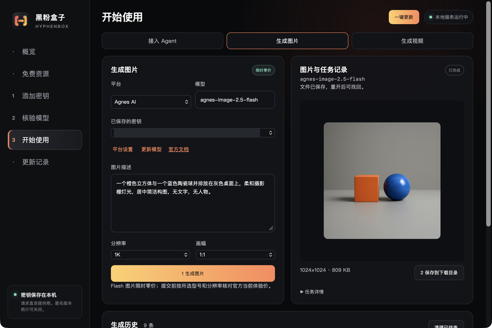

Agnes 每次派发前按所选型号和规格读取官方当前价格，未确认零价就停止。Cloudflare 必须使用 Workers Free 计划；账户试用类平台需确认拥有对应权益，未启用充值或付费结算。没有合格免费渠道时停止，不自动充值，不改用付费密钥，也不自动跨平台重新生成。AI Horde 匿名队列公开共享；Pollinations 描述经网址发送并按网址共享缓存，请勿输入私人资料。

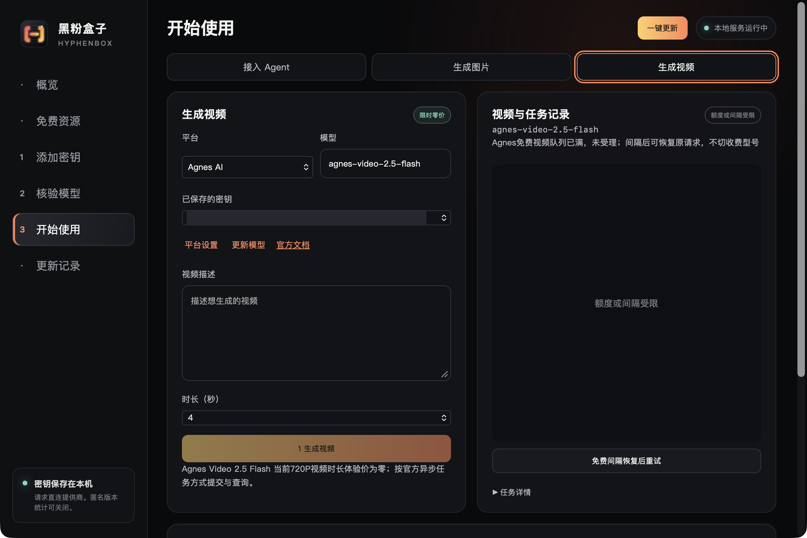

平台的提交路径、参数、结果字段、异步查询和模型列表由通用配置描述。同协议的新模型可更新列表或输入官方编号，复用现有流程；协议或输入形态不同仍需调整平台模板，不能保证所有图像编辑与参考视频协议都通用。可在「平台设置」维护已有配置或新增独立的自定义平台，密钥仍只保存在保险箱。媒体配置随本版应用提供，本机修改立即生效；目前不会由签名资源目录自动下发媒体协议模板。

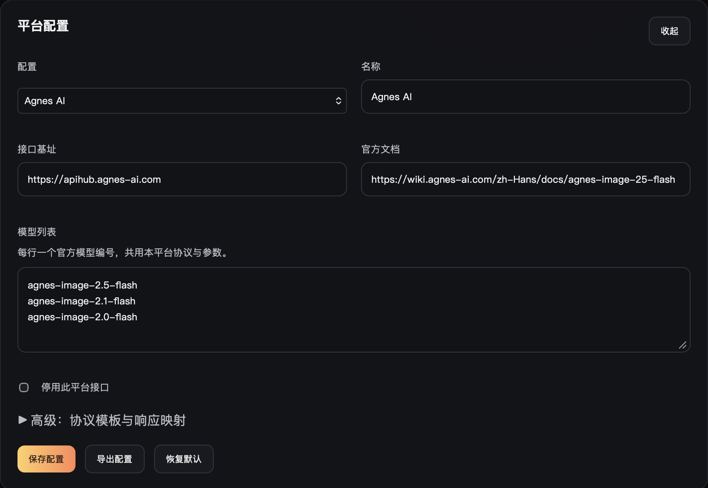

生成历史默认只展开最近六条，可展开较早记录。每条右侧「移除」，列表上方「清理已结束」按图片或视频分别清理；进行中的任务受保护。「撤销上次清理」在重开后仍可使用。清理只整理历史列表，生成文件、另存文件、原始调用记录与幂等键保留，不会因移除历史而再次生成，也不等于释放文件占用的空间。

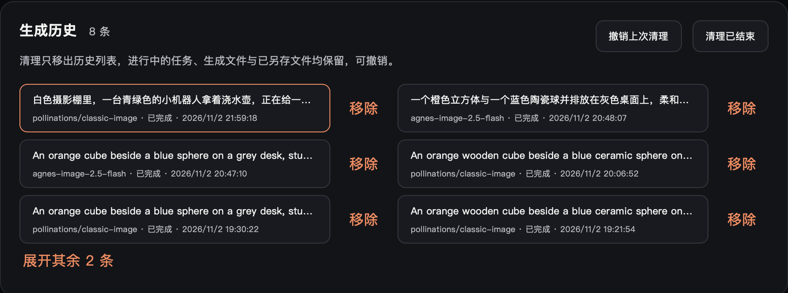

任务先入库再提交，保存实际平台、型号、参数和协议快照。取得上游编号后只查询和下载原任务；结果未知不自动重交。每次提交、查询、失败响应与下载各自留档，文件保存前检查格式、尺寸、时长与哈希。Harness 原生媒体工具读取相同的渠道与参数配置，新增同协议模型不需要增加独立工具；媒体不会换算为文字 Token 或虚构省钱金额。

本版验证安装、平台选择、清理撤销、历史与文件保留，并用本地协议夹具验证异步恢复及付费限制，按作者要求未逐个平台发起新的真实生成。1.0.6 的真实 Agnes 图片和 Harness 调用记录继续保留为历史证据；当时的视频请求因队列拥挤未取得成片，不能作为本版新增渠道成功出片的证明。

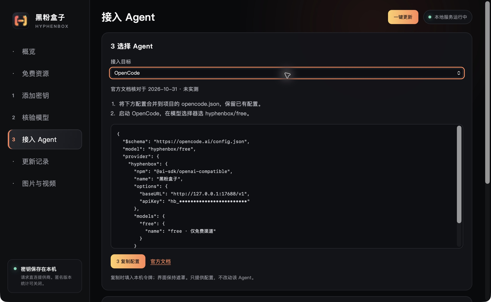

[OpenCode](https://opencode.ai/docs/providers/#custom-provider)、[Cline](https://docs.cline.bot/provider-config/openai-compatible)、[Roo Code](https://docs.roocode.com/providers/openai-compatible)、[Continue](https://docs.continue.dev/customize/model-providers/top-level/openai) 和 [Codex CLI](https://developers.openai.com/codex/config-advanced/#custom-model-providers) 的指引核对于 2026-10-31。[Cursor 官方说明](https://cursor.com/docs/settings/api-keys)请求经过其服务器，不能将本机回环地址当成直接接入方案，旧指引已移除。

## free 与 auto 怎么选

- `free`：只在符合已知免费条件、通过核验且适合当前请求的路线中尝试。免费档可能有每日、每分钟或账户额度限制，不能保证无限调用。
- `auto`：综合模型能力、请求大小、费用信息和失败冷却自动选路，**可能使用你已添加的付费路线**。只想用免费范围时，请选 `free`。
- 手选模型：明确指定某条路线；该模型是否支持工具、上下文长度及输出限制，仍受上游约束。

遇到限流、额度不足或服务错误，路由器会按错误分类冷却并尝试其他合格候选。全部候选不可用时会如实返回错误。已经向客户端输出内容的流式请求不会被承诺无缝换成另一个模型；软件也不能凭空恢复平台额度。
### 免费候选尽量试完（1.0.3 起）

客户端选择 `free` 后，不再按固定换路次数或四把密钥上限提前停止。它会在本次已添加、已核验、启用且适合请求的免费候选中继续寻找；换路线时优先尚未尝试的平台。冷却、待授权、不支持所需能力或不再免费等候选会按当前状态跳过，派发前再次复核本机免费资格，不自动切入自费凭据或收费模型。

接通前总预算为 5 分钟，单次尝试最多 60 秒；有效流式输出开始后，不受这项换路预算截断。同一路线与凭据组合不重复派发，只保留一次明确参数上限的自愈重试。到时仍有候选未试完，会报告剩余路线和停止原因，不把“还没试完”写成“所有平台没额度”。客户端自己的超时可能更短，平台额度也不会因此被预留；`auto` 暂保留原有有界换路策略。

### 减少密码弹窗与中断接续（1.0.2 起）

普通调用不主动弹出系统密码框，同一密钥的并发读取合并，失败后退避。Mac 新增和迁移后的密钥保存在一个应用钥匙串条目中；可在「密钥保险箱 → 减少密码弹窗与恢复授权」前台授权。旧版独立条目首次迁移可能仍逐项询问；系统锁定、权限或签名变化仍可能要求再次授权，不能承诺永久只输入一次密码。密钥不改存明文文件。

某把密钥暂不可读时，`free`／`auto` 会隔离该凭据并尝试其他合格路线，不把本机授权失败说成上游额度用完。明确的结构化额度错误（包括 HTTP 200 包装的错误）会参与冷却与换路；正常回答或内容拒绝不会因提到额度而被判成额度错误。

当前工具轮已经交回全部工具结果时，可整理成已执行检查点，移除旧提供商签名后交给替代模型继续；不会自动重放旧工具调用。缺结果、编号冲突或已输出一半的流式回答仍不能保证无缝恢复。换路不保证模型能力或回答风格不变。最近五条记录可在「接入 Agent → 自动换路与工具接续记录」查看；接通上游不代表整个任务完成。

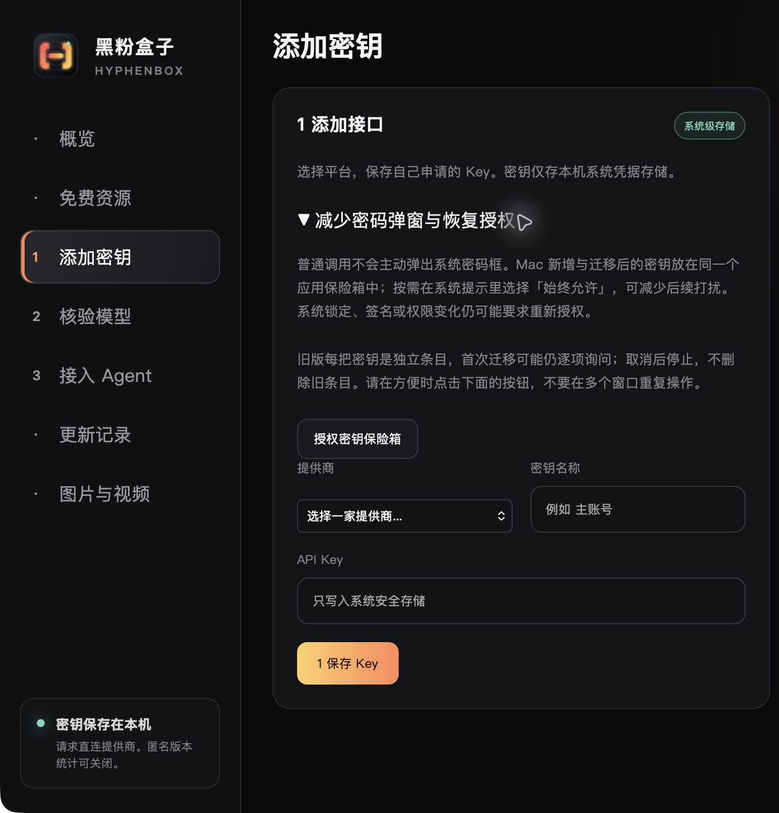

下面是 1.0.3 的历史真实换路记录（2026-10-24，未改标为本版新图）：首家平台的账户令牌额度装不下请求，随后转到另一家免费路线。它是这次测试的结果，不代表所有账户或任务都能成功。

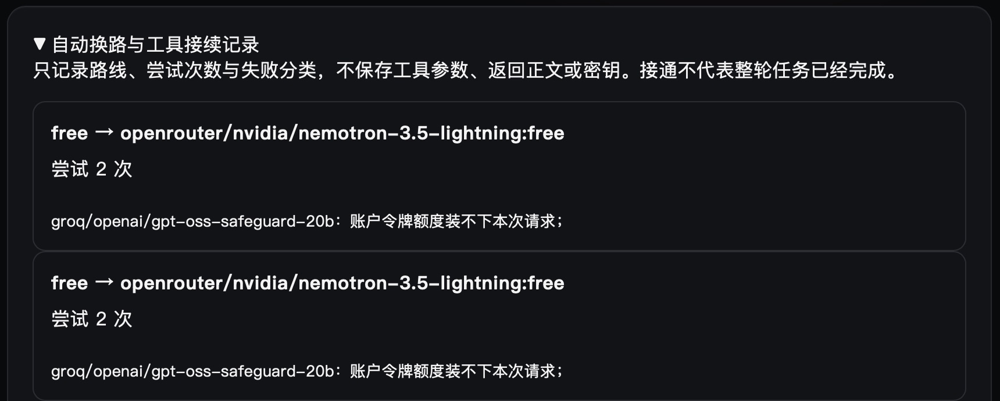
### 本机用量与当前标价估值

统计按实际使用凭据的当前声明分为免费额度、自费与未声明，未知不会自动计入免费成果。负数价格占位、非数字和无穷值不参与估值；没有有效单价和明确零价分别显示。当前单价估值不是账单，也不是已节省的金额，软件不再固定声称实付零元。

修改单价或计费声明会改变历史汇总；历史请求没有当时的账单快照。次数为请求记录，包含开始后中断的流式请求；模型数为平台与模型组合，不能等同于独立底座模型或完整任务成功数。

用量明细与统计口径可在首页“白嫖成果”展开查看；首页只保留累计成果和总体概况。

专用安全分类模型（如 Qwen3Guard、Llama Guard、GPT OSS Safeguard）按安全分类用途隔离，已有路由也不会再进入 free／auto 通用对话候选；不删除用户历史用量。
<!-- evergreen:capabilities:end -->

## 下载安装

[最新版下载入口](https://github.com/HackerChi-Hub/hyphenbox-release/releases/latest)会随正式发行更新。下面是当前 **1.0.7** 实际已上传的安装件；未列出的平台不代表已有本版安装包：

| 系统 | 安装包 | 要求 |
|---|---|---|
| macOS | [通用 DMG](https://github.com/HackerChi-Hub/hyphenbox-release/releases/download/v1.0.7/HyphenBox_1.0.7_universal.dmg) | macOS 13 及以上，Apple 芯片 / Intel |

本次 **1.0.7 提供 macOS 通用包**，支持 Apple 芯片与 Intel。Windows/Linux 本轮由作者在其他设备构建，尚无 1.0.7 安装件；不把旧包标成新版。

**本轮验证范围**：1.0.7 Mac 安装、实际界面、平台与参数选择、历史清理与撤销、旧记录和文件保留，以及本地协议故障与免费条件回归。本轮未逐平台新增真实生成，也未新增对话换路或 Win/Linux 运行结论。
Windows/Linux 继续使用[已公开的1.0.5安装件](https://github.com/HackerChi-Hub/hyphenbox-release/releases/tag/v1.0.5)，不包含1.0.6及之后新增的媒体工具。原版Windows使用本机MSVC、Linux使用WSL Ubuntu 22.04构建，原有回归和Linux隔离启动、目录验签与鉴权记录保留原版本标记。1.0.5 Windows/Linux使用内置签名目录，未预置在线目录服务；模型核验、路由和调用仍可使用本人的密钥，在线目录刷新需另行配置受控服务。

软件免费下载，不需要注册黑粉盒子账号；调用平台 API 通常仍需自行注册平台账户和申请凭据。部分平台需要国际网络，地区、实名、支付与额度条件以平台官方要求为准。

<!-- evergreen:installation-privacy:start -->
### 按步骤开始使用

1. 在「免费资源」查看资源条件，到平台官方入口申请自己的密钥，再存入「添加密钥」。
2. 在「核验模型」拉取模型列表、加入候选并核验；通过后才能作为可用路线使用。
3. 在「开始使用」选择用途：接入 Agent、生成图片或生成视频。Agent 首选 Harness；媒体页面选择平台、已保存密钥和模型后生成并保存。

接入 Agent 后保持黑粉盒子运行，新启 Agent、新建会话，模型选 `free`，再执行自己的任务。直接生成媒体无需先接入 Agent。

### 首次打开与签名

正式推出不等于已取得商业代码签名：macOS 当前使用固定本地签名，尚未完成 Apple Developer ID 签名和公证；Windows 安装件尚无商业代码签名，可能出现 SmartScreen 提示。macOS 被拦截时，可在确认来源后按「系统设置 → 隐私与安全性 → 仍要打开」处理。

请只从本仓库的发行页下载，并核对随发行提供的 SHA-256 校验文件。**更新器签名与系统商业代码签名是两件事。**

## 接口与兼容范围

提供 `/v1/models`、`/v1/chat/completions`（含流式）、`/v1/embeddings`，以及旧版 `/v1/completions` 和 `/v1/responses` 的兼容转换。媒体独立使用 `/v1/images/generations`、`/v1/videos/generations` 和 `/v1/media/jobs`；图片同步等待未完成时返回原任务编号，不能当成完成或换键重发。所有任务查询和文件下载均需本地令牌。

兼容接口不代表每家提供商都支持全部功能。工具调用、思考签名、多模态、输出上限等仍有模型和协议差异；图片、视频、音频及重排序生成不能一概当成已由本地聊天接口支持。长回答截断时，可先在「接入 Agent → 最近调用与结束原因」查看输出预算及结束原因，再核对客户端参数和平台限制。

## 软件更新与资源更新

顶栏「一键更新」检查签名目录和软件新版本。目录更新通过验证后独立应用，不要求每次都发新安装包；应用升级读取公开发行页的更新清单。

安装件与更新清单以本版发行页为准。更新包使用离线私钥签名，客户端用内置公钥验证后才应用。若某个平台暂未提供更新器条目，或旧版无法自动升级，可从发行页手动下载该平台已有的安装件。

## 隐私与公开边界

- 平台密钥保存在本机系统凭据存储中。本地统一令牌保存在应用数据目录，用于本机回环接口鉴权。
- 媒体任务会在本机保存描述、上游任务编号、响应记录和生成文件，用于恢复与排查；公开截图与发行资产不包含这些私有原始记录。图片公开端点具有上文说明的网址缓存边界。
- 模型调用从本机发往所选提供商，必要的认证信息、提示词与回答**不经过黑粉盒子的目录或统计服务器**。提供商仍会收到调用数据，请阅读其隐私政策。
- 匿名版本统计默认开启，可在应用内关闭；每个 UTC 日最多上报一次，字段包含匿名设备哈希、软件版本、系统、架构与日期，不包含密钥、对话、用量或所用提供商和模型。
- 开关位于「接入 Agent → 提升使用体验」，默认折叠；展开可查看统计范围、状态并关闭，不改变你已有的选择。
- 本仓库只公开下载、说明、截图与更新元数据。**源码、免费资源目录、原始采集与核验资料、私有服务配置、签名私钥均不在此公开。**
- 不采集或分享泄露密钥，不提供共享账户或绕过额度限制的密钥池。“免费 API”指平台允许的免费权益，不是永久可用保证。

## 反馈问题

请在 [Issues](https://github.com/HackerChi-Hub/hyphenbox-release/issues) 附上系统、黑粉盒子版本、客户端名称、复现步骤及脱敏错误。运行日志路径：

- Windows：`%LOCALAPPDATA%\top.hyphentech.hyphenbox\logs\hyphenbox.log`
- macOS：`~/Library/Logs/top.hyphentech.hyphenbox/hyphenbox.log`
- Linux：`~/.local/share/top.hyphentech.hyphenbox/logs/hyphenbox.log`

日志有认证信息脱敏处理，但提交前仍请检查内容。**不要把完整密钥、令牌、账号信息、私人对话或私有服务地址放进 Issue、日志附件和截图。**
<!-- evergreen:installation-privacy:end -->

---

黑粉科技 · [更多自制软件与文章](https://github.com/HackerChi-Hub)

<!-- evergreen:use-cases:start -->
## 适合哪些需求

| 需求 | 使用方法 |
| --- | --- |
| 找免费大模型 API | 按免费类型、额度、申请门槛和核对日期筛选官方资源 |
| 给 AI 编程工具配置接口 | 使用一键连接指引，配置本地统一地址与令牌 |
| 管理多平台模型和密钥 | 自己申请密钥，在本机保存、拉取模型并真实核验 |
| 处理限流或输出截断 | 看最近调用诊断，再核对路线、预算、结束原因和平台限制 |

## 常见问题

**免费 API 是永久无限使用吗？** 不是。免费档、试用与限时活动不同，平台可以调整权益；目录信息也不等于你的账户已通过调用验证。

**只想用免费路线该怎么选？** 使用 `free`。`auto` 可能调用你已添加的付费路线，费用仍受所选提供商规则约束。

**是本地大模型运行器吗？** 黑粉盒子主要管理提供商 API 与统一路由；需要在电脑上运行模型，可使用方寸智匣。

**会替我申请账号和密钥吗？** 不会。申请、地区与身份条件按平台官方要求完成，再用自己的凭据核验。
<!-- evergreen:use-cases:end -->

<!-- evergreen:discovery:start -->
## 黑粉科技自制软件

按需求选用，也可以组合使用：本地模型交给方寸智匣，云端接口交给黑粉盒子，录制教程用黑粉录屏，影视英语学习用光影词库。

| 软件 | 适合解决的问题 | 官方下载 |
| --- | --- | --- |
| 方寸智匣 LocalBrain | 本地大模型、文件与媒体工作台 | [下载方寸智匣](https://github.com/HackerChi-Hub/localbrain-releases) |
| 黑粉录屏 HyphenScreen | 屏幕录制、教程剪辑、字幕与动画 | [下载黑粉录屏](https://github.com/HackerChi-Hub/HyphenScreen-Releases) |
| 光影词库 ScreenLex | 看电影学英语、字幕查词、生词复习 | [下载光影词库](https://github.com/HackerChi-Hub/screenlex-download) |
| 黑粉盒子 HyphenBox | 免费 AI API 发现、模型核验与统一接口 | [下载黑粉盒子](https://github.com/HackerChi-Hub/hyphenbox-release) |

## 分享与反馈

分享给朋友时，请复制本仓库首页或[官方网站](https://hyphentech.top)，让对方按自己的系统下载当前安装包。欢迎收藏仓库、点亮 Star，或在本仓库 Issues 提交使用体验、需求和脱敏问题。

关注[哔哩哔哩「黑粉科技」](https://space.bilibili.com/1846717524)、[YouTube 黑粉科技频道](https://www.youtube.com/@hyphentech_top)；公众号和视频号搜索「黑粉科技」，查看实际演示与使用教程。
<!-- evergreen:discovery:end -->
