<!-- evergreen:intro:start -->
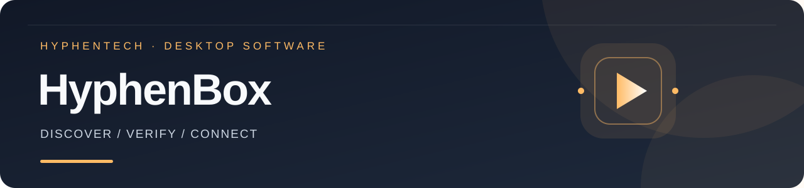

# 黑粉盒子 HyphenBox · 免費 AI API 雷達、模型核驗與統一介面

**找到合適的免費 AI 介面，用自己的金鑰測通，再接入常用 AI 程式設計工具。**

黑粉盒子是黑粉科技開發的桌面 AI API 管理工具，把免費資源發現、本機金鑰保險箱、模型核驗和本地統一路由放在一起。適合尋找免費大模型 API、管理多個提供商，或給 DeepSeek Harness、OpenCode、Cline 配置相容介面的使用者。資源條件有官方證據與核對日期；模型是否能用，以你自己的賬戶和真實請求為準。

軟體免費下載，不需註冊黑粉盒子賬號。平臺金鑰需自行申請，部分平臺需要國際網路；免費額度、地區和賬戶條件以平臺為準。

<a href="README.md">简体中文</a> | <a href="README.zh-TW.md">繁體中文</a> | <a href="README.en.md">English</a>

 

<!-- evergreen:intro:end -->

<!-- recent-features:start -->
## 近期新增與改進（最近 5 項）

- **1.0.7** · 圖片與影片歷史支援單筆移除、批次清理已結束及復原；預設最近六筆，重開後仍可恢復。
- **1.0.7** · 新增可重用平台協定設定；統一平台、已保存金鑰、模型及參數，同協定新模型不需專用程式碼。
- **1.0.7** · 週期額度、限時零價、社群佇列及新用戶試用分開；先確認帳戶條件，付費與未聲明金鑰不放行。
- **1.0.7** · 提交、查詢、失敗響應與下載獨立留檔；恢復只處理原任務，歷史清理仍保留檔案與冪等鍵。
- **1.0.7** · Harness原有8項原生媒體工具讀取同一套渠道與參數，圖片及影片沿用統一第3步入口。
<!-- recent-features:end -->

<!-- evergreen:demos:start -->
## ▶ 使用示範

**早期版本的金鑰儲存、客戶端設定與 MCP 演示；YouTube 為完整介紹。影片不展示新版 Harness 接入。**

| Bilibili | YouTube |
| :---: | :---: |
|  |  |

影片示範的是拍攝時的版本；安裝套件與目前功能以本頁正式發行資訊為準。影片以中文講解。
<!-- evergreen:demos:end -->

**當前正式版：1.0.7** · [發行說明](https://github.com/HackerChi-Hub/hyphenbox-release/releases/tag/v1.0.7)

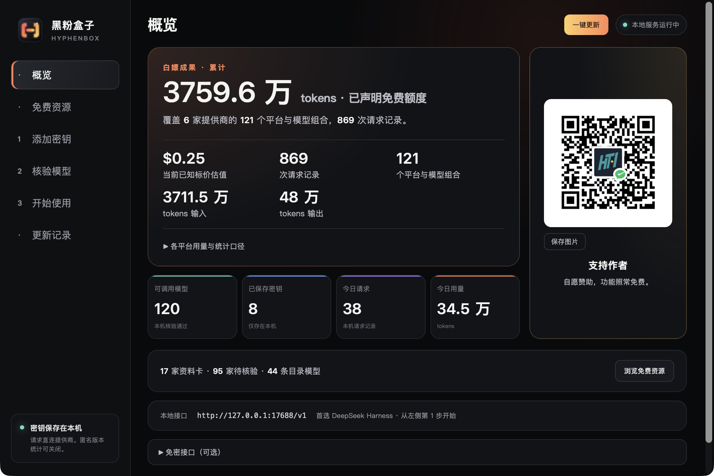

截圖拍攝於 2026 年 11 月 2 日：概覽及本輪媒體介面來自安裝後的 macOS 1.0.7 正式版；其餘截圖保留檔名中的 1.0.6 歷史版本。數字代表拍攝設備當時狀態，帳戶與私人資訊已裁去；歷史換路圖另標版本。

<!-- evergreen:capabilities:start -->
## 它能做什麼

免費清單解決“到哪裡找”，卻不能回答“我這把金鑰現在能不能用”。黑粉盒子把資源發現和本機呼叫分開處理：先看官方條件，再用自己的賬戶核驗，最後接入客戶端。

| 功能 | 當前能力 |
|---|---|
| 免費 API 雷達 | 搜尋和篩選資源，檢視免費型別、額度、申請門檻、介面地址、模型清單、風險、官方證據及核對日期；區分資料卡和待核驗候選 |
| 金鑰保險箱 | 儲存自己從官方渠道取得的金鑰，使用系統憑據儲存；介面預設遮罩，支援多把金鑰 |
| 模型發現與核驗 | 用自己的金鑰拉取模型列表，篩選免費模型、批次加入併傳送最小真實請求；對話和向量模型按用途驗證，不把向量模型拿去做聊天測試 |
| 費用與能力標識 | 區分完全免費、免費額度、扣餘額、價格未知和自費；展示核驗狀態、工具呼叫能力等資訊，未知價格不會自動算免費 |
| 本地統一路由 | 只監聽 `127.0.0.1`，提供相容介面、多金鑰嘗試、限流冷卻和故障切換；免費路線與一般自動路線分開 |
| Agent 接入 | 首選 DeepSeek Harness，一次接入對話與圖片／影片工具，支援備份與撤銷；原生工具隨安裝包提供，無需另裝執行環境。其他 Agent 保留官方文件設定指引 |
| 免費圖片與影片工具 | 統一選平台、金鑰及模型，重用平台協定設定；免費與試用條件分開。歷史可單筆移除、批次清理及復原，不自動切付費 |
| 媒體任務與檔案 | 先儲存任務再提交，同一任務不重複生成；保留狀態、事件與檔案雜湊。已受理影片只查詢原任務，重新開啟可恢復查詢 |
| 自願贊助 | 三平臺首頁直接顯示隨包贊助碼，不依賴用量或網路；贊助不解鎖功能，也不影響免費使用 |
| 呼叫診斷與統計 | 檢視本機請求與詞元用量；最近呼叫診斷顯示輸出預算、結束原因等資訊，幫助區分輸出長度限制、限流和上游錯誤 |
| 獨立目錄更新 | 軟體定期讀取受控的簽名目錄，驗證簽名、版本和檔案雜湊；更新資源資訊不必重新下載安裝包 |

### 免費 API 雷達

免費檔、一次性試用、限時活動與開源自託管不是同一回事。先看免費型別、申請條件和核對日期，再回到平臺官方頁面確認自己賬戶的權益。資料卡里的模型清單也不能代替本機真實呼叫。

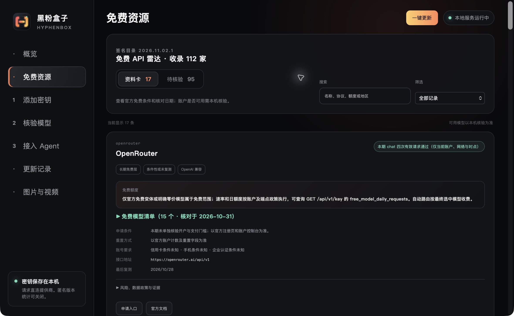

### 模型與路由

模型列表來自你自己的憑據，路由資格來自本機核驗結果。可以批次加入免費模型、核驗待驗證路線，也可以重新核驗、停用或刪除單條路線。向量模型走向量介面；語音、影象、影片與重排序等用途目前不能全部自動核驗，也不會混入聊天介面。

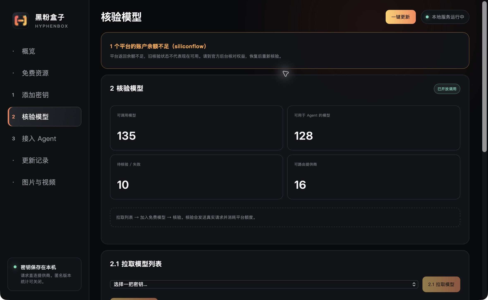

### 接入 Agent

統一地址是 `http://127.0.0.1:17688/v1`，客戶端使用黑粉盒子的本地統一令牌，不需要逐個平臺填寫上游金鑰。DeepSeek Harness 可以直接寫入配置並撤銷；其他客戶端按應用內指引手動填寫。面向智慧體客戶端的模型列表會篩掉已實測不支援工具呼叫的路線。

Harness 使用官方對話適配器與 MCP 用戶端外掛，追加受管對話設定與原生媒體工具，不複製上游金鑰；原有提供商及私人會話保留。連接後請新啟 Harness 程序、建立新會話。一鍵接入預設 `free`，沒有合格免費對話模型時停止寫入，不自動改選付費路線。撤銷會移除受管對話、媒體工具與本機令牌，不刪除其他設定或會話。

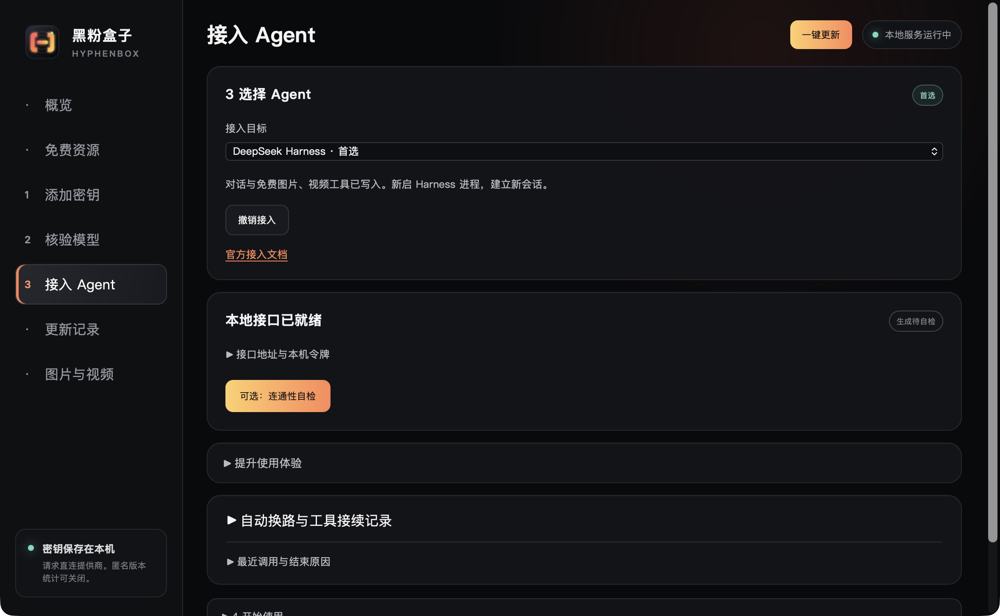

左側統一為 **1 新增金鑰 → 2 核驗模型 → 3 開始使用**。第3步包含「接入Agent／生成圖片／生成影片」；直接生成媒體不用先連接Agent，文字模型仍須在第2步核驗。Harness接入後新啟進程、新建會話。底部沒有固定欄，手動範本預設free。安裝版原生橋已由Harness獨立會話完成渠道查詢、圖片生成、查詢及儲存；影片提交與佇列恢復另做真實請求，未取得成片。其他Agent指引不代表本輪實測。

### 圖片與影片

在「3 開始使用」選圖片或影片，再選平台、模型及本人已保存金鑰，按 **1 生成 → 2 儲存到下載目錄** 操作。免金鑰渠道獨立標明；需要帳戶免費權益的平台，先在「平台設定」填寫必要資訊、確認免費條件，再將金鑰計費性質設為「免費額度」。付費、未聲明及其他平台的金鑰不會進入免費媒體生成。

圖片設定包含 Agnes、智譜 CogView-3-Flash、Cloudflare Workers AI、AI Horde、ModelScope、Stability 與 WaveSpeed；影片設定包含 Agnes Video Flash、智譜 CogVideoX-Flash 與 WaveSpeed。保留 Pollinations Classic 免金鑰圖片入口。週期額度、限時零價、社群免費佇列、帳戶免費權益與新用戶一次性試用分開顯示；試用不等於永久免費。平台範圍依官方資料，權益、地區、限流及可用性仍依本人帳戶與上游狀態。

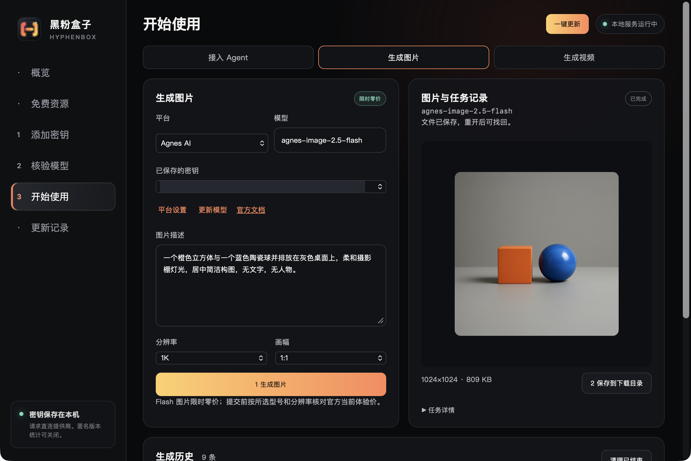

Agnes 每次派發前依所選型號及規格核對官方當前零價，無法確認便停止。Cloudflare 必須使用 Workers Free 方案；帳戶試用平台須確認相應權益，沒有儲值或付費結算。沒有合格免費渠道便停止，不自動儲值、不改用付費金鑰，也不自動跨平台重新生成。AI Horde 匿名佇列公開分享；Pollinations 描述經網址傳送並共用快取，請勿輸入私人資料。

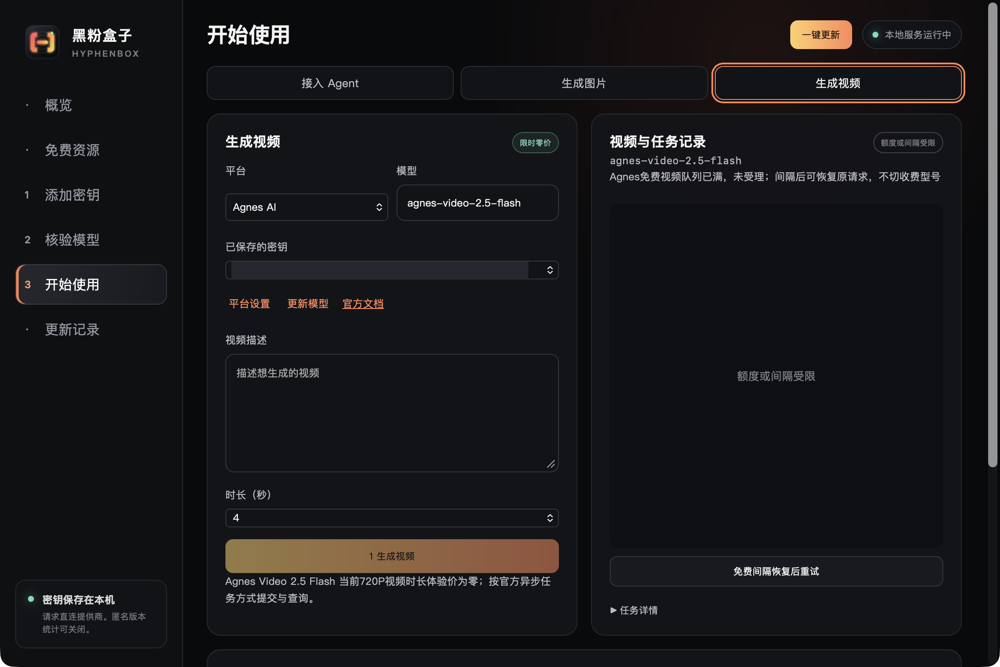

提交路徑、參數、結果欄位、非同步查詢與模型清單由通用設定描述。同協定新模型可更新清單或輸入官方編號；不同協定與輸入形態仍需調整平台範本，不保證所有圖片編輯或參考影片協定通用。「平台設定」可維護既有設定或新增獨立自訂平台，金鑰仍只存保險箱。媒體設定隨應用提供，本機修改即時生效；目前不由簽章資源目錄自動下發媒體協定範本。

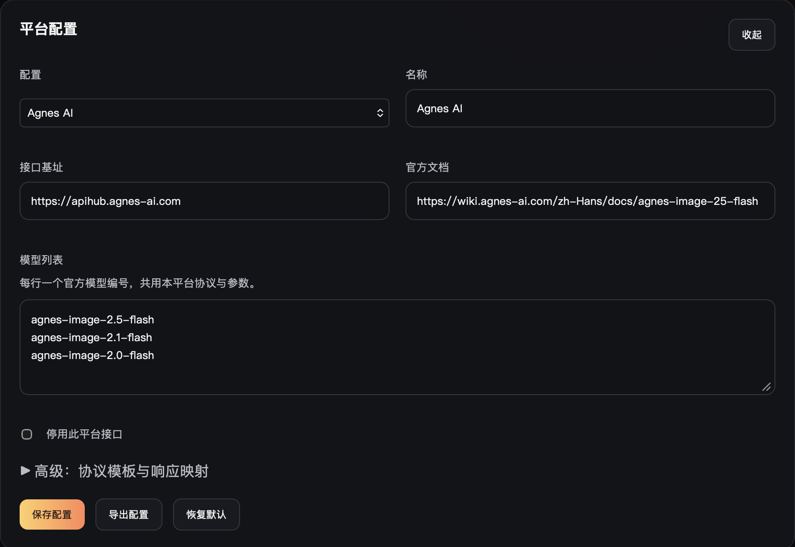

歷史預設只展開最近六筆，可展開較早紀錄。每筆右側「移除」，上方「清理已結束」分圖片或影片處理；進行中的任務受保護。「復原上次清理」重新開啟後仍可使用。清理只整理歷史清單，生成檔案、另存檔案、原始呼叫紀錄及冪等鍵保留，不會因此重複生成，也不等於釋放檔案空間。

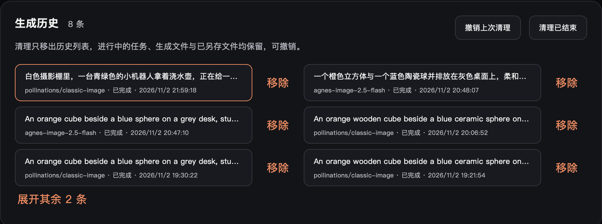

任務先落盤，保存平台、型號、參數與協定快照。取得上游編號後只查詢及下載原任務；結果未知不自動重交。提交、查詢、失敗響應與下載分別留檔，儲存前核對格式、尺寸、時長及雜湊。Harness 原生媒體工具讀取同一套渠道與參數，新同協定模型不需獨立工具；媒體不換算文字 Token 或虛構省錢金額。

本版驗證安裝、平台選擇、清理復原與檔案保留，並以本機協定夾具驗證非同步恢復及付費限制；依作者要求，沒有逐平台執行新的真實生成。1.0.6 的 Agnes 圖片與 Harness 呼叫紀錄保留為歷史證據；當時影片因佇列擁擠未取得成片，不作為本版新增渠道已出片的證明。

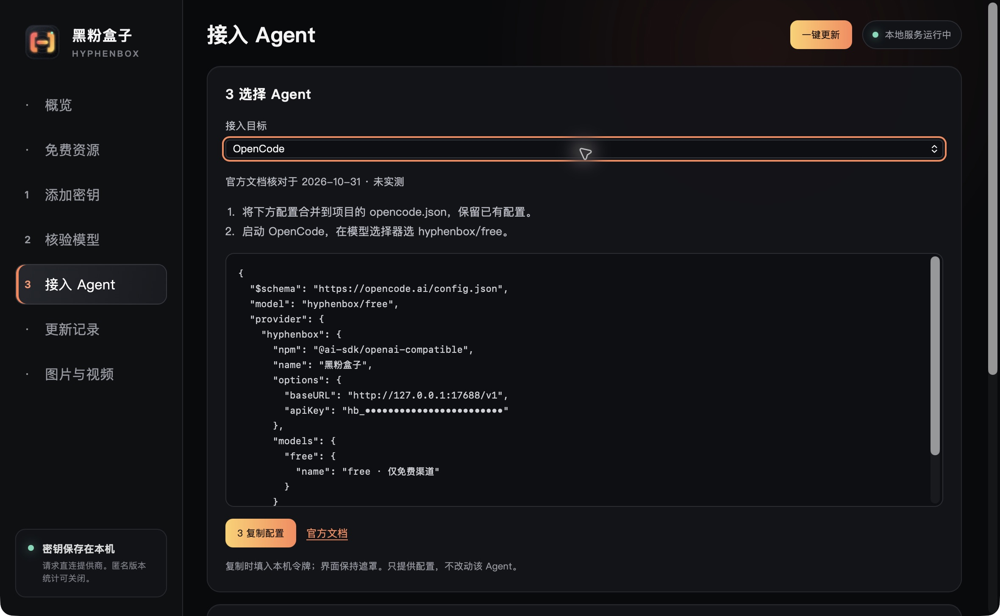

官方依據：[OpenCode](https://opencode.ai/docs/providers/#custom-provider)、[Cline](https://docs.cline.bot/provider-config/openai-compatible)、[Roo Code](https://docs.roocode.com/providers/openai-compatible)、[Continue](https://docs.continue.dev/customize/model-providers/top-level/openai)、[Codex CLI](https://developers.openai.com/codex/config-advanced/#custom-model-providers)，核對於 2026-10-31。[Cursor 官方說明](https://cursor.com/docs/settings/api-keys)請求經過其伺服器，不能直接使用本機迴環地址，舊指引已移除。

## free 與 auto 怎麼選

- `free`：只在符合已知免費條件、透過核驗且適合當前請求的路線中嘗試。免費檔可能有每日、每分鐘或賬戶額度限制，不能保證無限呼叫。
- `auto`：綜合模型能力、請求大小、費用資訊和失敗冷卻自動選路，**可能使用你已新增的付費路線**。只想用免費範圍時，請選 `free`。
- 手選模型：明確指定某條路線；該模型是否支援工具、上下文長度及輸出限制，仍受上游約束。

遇到限流、額度不足或服務錯誤，路由器會按錯誤分類冷卻並嘗試其他合格候選。全部候選不可用時會如實返回錯誤。已經向客戶端輸出內容的流式請求不會被承諾無縫換成另一個模型；軟體也不能憑空恢復平臺額度。
### 盡量試完免費候選（1.0.3 起）

客戶端選擇 `free` 後，不再按固定換路次數或四把金鑰上限提前停止，會繼續尋找本次已加入、已核驗、啟用且適合請求的免費候選；換路線時優先尚未嘗試的平臺。冷卻、待授權、能力不符或不再免費的候選依目前狀態跳過，派發前再次核對本機免費資格，不自動轉入自費憑證或收費模型。

接通前總預算為 5 分鐘，單次嘗試最多 60 秒；有效串流輸出開始後不受這項換路預算截斷。同一路線與憑證組合不重複派發，只保留一次明確參數上限的自癒重試。到時仍未試完會報告剩餘路線與停止原因，不說成所有平臺額度耗盡。客戶端自己的逾時可能更短，平臺額度不會因此預留；`auto` 暫保留原有有界換路策略。

### 減少密碼彈窗與中斷接續（1.0.2 起）

一般呼叫不主動彈出系統密碼框，同一金鑰的併發讀取合併，失敗後退避。Mac 新增和遷移後的金鑰儲存在同一應用程式鑰匙圈項目中，可在金鑰保險箱中主動授權。舊版獨立項目首次遷移可能仍逐項詢問；系統鎖定、權限或簽名變化仍可能要求再次授權，不能承諾永久只輸入一次密碼。金鑰不改存明文檔案。

某把金鑰暫時無法讀取時，`free`／`auto` 會隔離該憑證並嘗試其他合格路線，不把本機授權失敗說成上游額度耗盡。明確的結構化額度錯誤（包括 HTTP 200 包裝的錯誤）會參與冷卻與換路；一般回答或內容拒絕不會因提到額度而被誤判。

目前工具輪已交回全部工具結果時，可整理為已執行檢查點，移除舊提供商簽名後交給替代模型接續，不會自動重放舊工具呼叫。缺結果、編號衝突或已輸出一半的串流回答仍不能保證無縫恢復，換路也不保證模型能力和風格不變。最近五筆可在一鍵連接的自動換路與工具接續記錄查看；接通上游不代表整個任務完成。

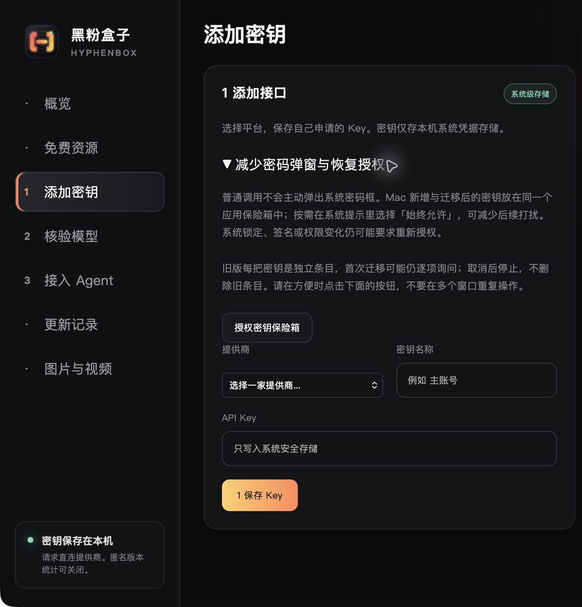

以下是 1.0.3 的歷史真實換路記錄（2026-10-24，未改標為本版新圖）：首家平臺的賬戶令牌額度容納不下請求，隨後改走另一家免費路線。這是當時的測試結果，不代表所有賬戶或任務都能成功。

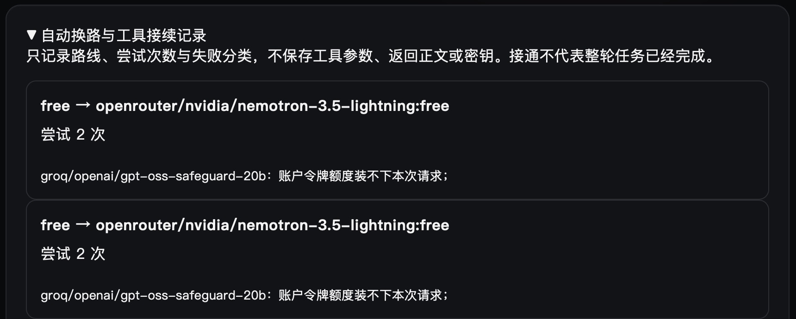
### 本機用量與目前標價估值

統計依實際使用憑證目前聲明分為免費額度、自費與未聲明，未知不自動計入免費成果。負數價格佔位、非數字與無窮值不參與估值；缺少有效單價與明確零價分開顯示。目前單價估值不是帳單，也不是已節省金額，不再固定聲稱實付零元。

修改單價或計費聲明會影響歷史彙總；歷史請求沒有當時的帳單快照。次數為請求記錄，包含開始後中斷的串流；模型數為平台與模型組合，不等於獨立底層模型或完整任務成功數。

用量明細與統計口徑在首頁「免費成果」按需展開；首頁僅保留累計成果與總體概況。

專用安全分類模型（如 Qwen3Guard、Llama Guard、GPT OSS Safeguard）依安全分類用途隔離，已有路由也不再進入 free／auto 通用對話候選；不刪除歷史用量。
<!-- evergreen:capabilities:end -->

## 下載安裝

[最新版下載入口](https://github.com/HackerChi-Hub/hyphenbox-release/releases/latest)會隨正式發行更新。下面是當前 **1.0.7** 實際已上傳的安裝件；未列出的平臺不代表已有本版安裝包：

| 系統 | 安裝套件 | 要求 |
|---|---|---|
| macOS | [通用 DMG](https://github.com/HackerChi-Hub/hyphenbox-release/releases/download/v1.0.7/HyphenBox_1.0.7_universal.dmg) | macOS 13 及以上，Apple 晶片 / Intel |

本次 **1.0.7 提供 macOS 通用包**，支援 Apple 晶片與 Intel。Windows/Linux 本輪由作者在其他設備建構，尚無 1.0.7 安裝件，不把舊包標成新版。

**本輪驗證範圍**：1.0.7 Mac 安裝、實際介面、平台與參數選擇、歷史清理與復原、原紀錄與檔案保留，以及本機協定故障與免費條件迴歸。本輪沒有逐平台新增真實生成，也未新增對話換路或 Win/Linux 執行結論。

Windows/Linux 繼續使用[已公開的1.0.5安裝套件](https://github.com/HackerChi-Hub/hyphenbox-release/releases/tag/v1.0.5)，不包含1.0.6及之後新增的媒體工具。原版Windows使用本機MSVC、Linux使用WSL Ubuntu 22.04建構；原有迴歸、Linux隔離啟動、目錄驗章與鑑權證據保留原版本。1.0.5 Windows/Linux使用內建簽章目錄，未預設線上目錄服務；模型核驗、路由及呼叫仍可使用本人的金鑰，線上目錄刷新需另行設定受控服務。

軟體免費下載，不需要註冊黑粉盒子賬號；呼叫平臺 API 通常仍需自行註冊平臺賬戶和申請憑據。部分平臺需要國際網路，地區、實名、支付與額度條件以平臺官方要求為準。

<!-- evergreen:installation-privacy:start -->
### 按步驟開始使用

1. 在「免費資源」檢視資源條件，到平臺官方入口申請自己的金鑰，再存入「新增金鑰」。
2. 在「核驗模型」拉取模型列表、加入候選並核驗；透過後才能作為可用路線使用。
3. 在「開始使用」選用途：接入 Agent、生成圖片或生成影片。Agent 首選 Harness；媒體頁選平台、已保存金鑰及模型後生成並儲存。

接入 Agent 後保持黑粉盒子執行，新啟 Agent、新建會話，模型選 `free`，再執行自己的任務。直接生成媒體不用先接入 Agent。

### 首次開啟與簽名

正式推出不等於已取得商業程式碼簽名：macOS 當前使用固定本地簽名，尚未完成 Apple Developer ID 簽名和公證；Windows 安裝件尚無商業程式碼簽名，可能出現 SmartScreen 提示。macOS 被攔截時，可在確認來源後按「系統設定 → 隱私與安全性 → 仍要開啟」處理。

請只從本倉庫的發行頁下載，並核對隨發行提供的 SHA-256 校驗檔案。**更新器簽名與系統商業程式碼簽名是兩件事。**

## 介面與相容範圍

媒體獨立提供 `/v1/images/generations`、`/v1/videos/generations` 與 `/v1/media/jobs`；查詢與下載均需本機令牌，尚未完成時只查詢原任務。

提供 `/v1/models`、`/v1/chat/completions`（含流式）、`/v1/embeddings`，以及舊版 `/v1/completions` 和 `/v1/responses` 的相容轉換。請求需要本地統一令牌，模型能力與可用範圍取決於實際路線。

相容介面不代表每家提供商都支援全部功能。工具呼叫、思考簽名、多模態、輸出上限等仍有模型和協議差異；圖片、影片、音訊及重排序生成不能一概當成已由本地聊天介面支援。長回答截斷時，可先在「接入 Agent → 最近呼叫與結束原因」檢視輸出預算及結束原因，再核對客戶端引數和平臺限制。

## 軟體更新與資源更新

頂欄「一鍵更新」檢查簽名目錄和軟體新版本。目錄更新透過驗證後獨立應用，不要求每次都發新安裝包；應用升級讀取公開發行頁的更新清單。

安裝件與更新清單以本版發行頁為準。更新包使用離線私鑰簽名，客戶端用內建公鑰驗證後才應用。若某個平臺暫未提供更新器條目，或舊版無法自動升級，可從發行頁手動下載該平臺已有的安裝件。

## 隱私與公開邊界

- 平臺金鑰儲存在本機系統憑據儲存中。本地統一令牌儲存在應用資料目錄，用於本機迴環介面鑑權。
- 模型呼叫從本機發往所選提供商，必要的認證資訊、提示詞與回答**不經過黑粉盒子的目錄或統計伺服器**。提供商仍會收到呼叫資料，請閱讀其隱私政策。
- 匿名版本統計預設開啟，可在應用內關閉；每個 UTC 日最多上報一次，欄位包含匿名裝置雜湊、軟體版本、系統、架構與日期，不包含金鑰、對話、用量或所用提供商和模型。
- 開關位於「一鍵連接 → 提升使用體驗」，預設摺疊；展開可查看統計範圍、狀態並關閉，不改變你既有的選擇。
- 本倉庫只公開下載、說明、截圖與更新後設資料。**原始碼、免費資源目錄、原始採集與核驗資料、私有服務配置、簽名私鑰均不在此公開。**
- 不採集或分享洩露金鑰，不提供共享賬戶或繞過額度限制的金鑰池。“免費 API”指平臺允許的免費權益，不是永久可用保證。

## 反饋問題

請在 [Issues](https://github.com/HackerChi-Hub/hyphenbox-release/issues) 附上系統、黑粉盒子版本、客戶端名稱、復現步驟及脫敏錯誤。執行日誌路徑：

- Windows：`%LOCALAPPDATA%\top.hyphentech.hyphenbox\logs\hyphenbox.log`
- macOS：`~/Library/Logs/top.hyphentech.hyphenbox/hyphenbox.log`
- Linux：`~/.local/share/top.hyphentech.hyphenbox/logs/hyphenbox.log`

日誌有認證資訊脫敏處理，但提交前仍請檢查內容。**不要把完整金鑰、令牌、賬號資訊、私人對話或私有服務地址放進 Issue、日誌附件和截圖。**
媒體描述、上游任務編號、響應和檔案會留在本機供恢復；不把私有原始記錄放入公開截圖或發行資產。
<!-- evergreen:installation-privacy:end -->

---

黑粉科技 · [更多自制軟體與文章](https://github.com/HackerChi-Hub)

<!-- evergreen:use-cases:start -->
## 適合哪些需求

| 需求 | 使用方法 |
| --- | --- |
| 找免費大模型 API | 按免費型別、額度、申請門檻和核對日期篩選官方資源 |
| 給 AI 程式設計工具配置介面 | 使用一鍵連線指引，配置本地統一地址與令牌 |
| 管理多平臺模型和金鑰 | 自己申請金鑰，在本機儲存、拉取模型並真實核驗 |
| 處理限流或輸出截斷 | 看最近呼叫診斷，再核對路線、預算、結束原因和平臺限制 |

## 常見問題

**免費 API 是永久無限使用嗎？** 不是。免費檔、試用與限時活動不同，平臺可以調整權益；目錄資訊也不等於你的賬戶已透過呼叫驗證。

**只想用免費路線該怎麼選？** 使用 `free`。`auto` 可能呼叫你已新增的付費路線，費用仍受所選提供商規則約束。

**是本地大模型執行器嗎？** 黑粉盒子主要管理提供商 API 與統一路由；需要在電腦上執行模型，可使用方寸智匣。

**會替我申請賬號和金鑰嗎？** 不會。申請、地區與身份條件按平臺官方要求完成，再用自己的憑據核驗。
<!-- evergreen:use-cases:end -->

<!-- evergreen:discovery:start -->
## 黑粉科技自制軟體

按需求選用，也可以組合使用：本地模型交給方寸智匣，雲端介面交給黑粉盒子，錄製教程用黑粉錄屏，影視英語學習用光影詞庫。

| 軟體 | 適合解決的問題 | 官方下載 |
| --- | --- | --- |
| 方寸智匣 LocalBrain | 本地大模型、檔案與媒體工作臺 | [下載方寸智匣](https://github.com/HackerChi-Hub/localbrain-releases) |
| 黑粉錄屏 HyphenScreen | 螢幕錄製、教程剪輯、字幕與動畫 | [下載黑粉錄屏](https://github.com/HackerChi-Hub/HyphenScreen-Releases) |
| 光影詞庫 ScreenLex | 看電影學英語、字幕查詞、生詞複習 | [下載光影詞庫](https://github.com/HackerChi-Hub/screenlex-download) |
| 黑粉盒子 HyphenBox | 免費 AI API 發現、模型核驗與統一介面 | [下載黑粉盒子](https://github.com/HackerChi-Hub/hyphenbox-release) |

## 分享與反饋

分享給朋友時，請複製本倉庫首頁或[官方網站](https://hyphentech.top)，讓對方按自己的系統下載當前安裝包。歡迎收藏倉庫、點亮 Star，或在本倉庫 Issues 提交使用體驗、需求和脫敏問題。

關注[嗶哩嗶哩「黑粉科技」](https://space.bilibili.com/1846717524)、[YouTube 黑粉科技頻道](https://www.youtube.com/@hyphentech_top)；公眾號和影片號搜尋「黑粉科技」，檢視實際演示與使用教程。
<!-- evergreen:discovery:end -->
